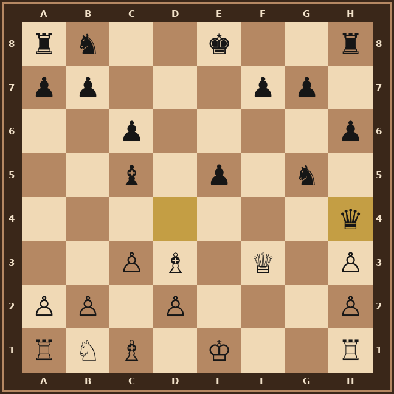

### Hello there! 👋

YouTube creator | Chess player | Gamer | Tech enthusiast

<!-- YT_STATS_START -->
  
<!-- YT_STATS_END -->

---

<!-- CHESS_START -->
### ♟️ Play chess with me!

⬜ **Your turn! Play White (bottom).** Any guest can make the next move. ⚠️ **CHECK!**

**Series score:** Krzys3n **0** : **0** Guests *(Draws: 0)*

#### 🎯 Choose a move (FROM → TO)

| FROM | TO - click a move |
| :---: | :--- |
| **E1** | [E2](https://github.com/Krzys3n/Krzys3n/issues/new?title=chess%3A%20e1e2&body=Chess%20move%3A%20%60e1e2%60%0A%0AClick%20%2A%2ACreate%20new%20issue%2A%2A%20to%20play%20this%20move.), [F1](https://github.com/Krzys3n/Krzys3n/issues/new?title=chess%3A%20e1f1&body=Chess%20move%3A%20%60e1f1%60%0A%0AClick%20%2A%2ACreate%20new%20issue%2A%2A%20to%20play%20this%20move.), [D1](https://github.com/Krzys3n/Krzys3n/issues/new?title=chess%3A%20e1d1&body=Chess%20move%3A%20%60e1d1%60%0A%0AClick%20%2A%2ACreate%20new%20issue%2A%2A%20to%20play%20this%20move.) |
| **F3** | [G3](https://github.com/Krzys3n/Krzys3n/issues/new?title=chess%3A%20f3g3&body=Chess%20move%3A%20%60f3g3%60%0A%0AClick%20%2A%2ACreate%20new%20issue%2A%2A%20to%20play%20this%20move.), [F2](https://github.com/Krzys3n/Krzys3n/issues/new?title=chess%3A%20f3f2&body=Chess%20move%3A%20%60f3f2%60%0A%0AClick%20%2A%2ACreate%20new%20issue%2A%2A%20to%20play%20this%20move.) |

**Surrender votes (1)** — [🏳️ Vote to surrender](https://github.com/Krzys3n/Krzys3n/issues/new?title=chess%3A%20surrender&body=Vote%20to%20surrender%20the%20current%20game.%0A%0AClick%20%2A%2ACreate%20new%20issue%2A%2A%20to%20submit%20your%20vote.)  
*If you feel that the position is lost, you can vote to surrender. If I see enough votes, I will reset the match and mark it as a win.*

#### How to play
Click a move link in **FROM → TO** to open a pre-filled Issue, then click **Create new issue**. GitHub Actions validates the move, updates the board, and closes the Issue. *(Inspired by [timburgan](https://github.com/timburgan)).*

#### 🤝 Fair play & community
Feel free to share my profile with friends who know the rules of chess and team up with them to find the best move! As a gentleman's agreement, **no chess engines** — I play my moves on my own, and you play yours with pure human brainpower.

#### Last few moves

| Move | Who |
| :--- | :--- |
| 🏳️ Surrender vote | [@Krzys3n](https://github.com/Krzys3n) |
| D4 to H4 | [@Krzys3n](https://github.com/Krzys3n) |
| C2 to C3 | [@uriel346as](https://github.com/uriel346as) |
| E4 to G5 | [@Krzys3n](https://github.com/Krzys3n) |
| B5 to D3 | [@Zafkieli](https://github.com/Zafkieli) |

#### Guest Leaderboard

| Moves | Guest |
| :---: | :--- |
| 7 | [@Mniok](https://github.com/Mniok) |
| 1 | [@Shiro99x](https://github.com/Shiro99x) |
| 1 | [@uriel346as](https://github.com/uriel346as) |
| 1 | [@Zafkieli](https://github.com/Zafkieli) |
<!-- CHESS_END -->
