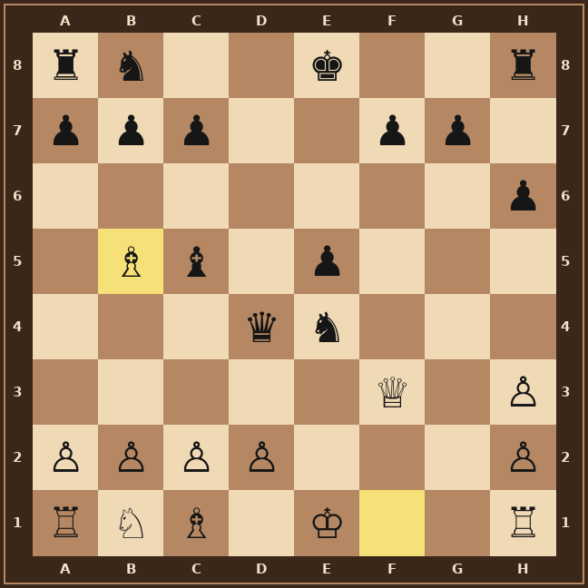

### Hello there! 👋

YouTube creator | Chess player | Gamer | Tech enthusiast

<!-- YT_STATS_START -->
  
<!-- YT_STATS_END -->

---

<!-- CHESS_START -->
### ♟️ Play chess with me!

⬛ **@Krzys3n's turn (Black — top).** Restricted to the profile owner. ⚠️ **CHECK!**

**Series score:** Krzys3n **0** : **0** Guests *(Draws: 0)*

#### 🎯 Choose a move (FROM → TO)

| FROM | TO - click a move |
| :---: | :--- |
| **B8** | [D7](https://github.com/Krzys3n/Krzys3n/issues/new?title=chess%3A%20b8d7&body=Chess%20move%3A%20%60b8d7%60%0A%0AClick%20%2A%2ACreate%20new%20issue%2A%2A%20to%20play%20this%20move.), [C6](https://github.com/Krzys3n/Krzys3n/issues/new?title=chess%3A%20b8c6&body=Chess%20move%3A%20%60b8c6%60%0A%0AClick%20%2A%2ACreate%20new%20issue%2A%2A%20to%20play%20this%20move.) |
| **C7** | [C6](https://github.com/Krzys3n/Krzys3n/issues/new?title=chess%3A%20c7c6&body=Chess%20move%3A%20%60c7c6%60%0A%0AClick%20%2A%2ACreate%20new%20issue%2A%2A%20to%20play%20this%20move.) |
| **D4** | [D7](https://github.com/Krzys3n/Krzys3n/issues/new?title=chess%3A%20d4d7&body=Chess%20move%3A%20%60d4d7%60%0A%0AClick%20%2A%2ACreate%20new%20issue%2A%2A%20to%20play%20this%20move.) |
| **E8** | [F8](https://github.com/Krzys3n/Krzys3n/issues/new?title=chess%3A%20e8f8&body=Chess%20move%3A%20%60e8f8%60%0A%0AClick%20%2A%2ACreate%20new%20issue%2A%2A%20to%20play%20this%20move.), [D8](https://github.com/Krzys3n/Krzys3n/issues/new?title=chess%3A%20e8d8&body=Chess%20move%3A%20%60e8d8%60%0A%0AClick%20%2A%2ACreate%20new%20issue%2A%2A%20to%20play%20this%20move.), [E7](https://github.com/Krzys3n/Krzys3n/issues/new?title=chess%3A%20e8e7&body=Chess%20move%3A%20%60e8e7%60%0A%0AClick%20%2A%2ACreate%20new%20issue%2A%2A%20to%20play%20this%20move.) |

**Surrender votes (1)** — [🏳️ Vote to surrender](https://github.com/Krzys3n/Krzys3n/issues/new?title=chess%3A%20surrender&body=Vote%20to%20surrender%20the%20current%20game.%0A%0AClick%20%2A%2ACreate%20new%20issue%2A%2A%20to%20submit%20your%20vote.)  
*If you feel that the position is lost, you can vote to surrender. If I see enough votes, I will reset the match and mark it as a win.*

#### How to play
Click a move link in **FROM → TO** to open a pre-filled Issue, then click **Create new issue**. GitHub Actions validates the move, updates the board, and closes the Issue. *(Inspired by [timburgan](https://github.com/timburgan)).*

#### Last few moves

| Move | Who |
| :--- | :--- |
| F1 to B5 | [@Mniok](https://github.com/Mniok) |
| F8 to C5 | [@Krzys3n](https://github.com/Krzys3n) |
| G4 to F3 | [@Shiro99x](https://github.com/Shiro99x) |
| D8 to D4 | [@Krzys3n](https://github.com/Krzys3n) |
| D1 to G4 | [@Krzys3n](https://github.com/Krzys3n) |

#### Guest Leaderboard

| Moves | Guest |
| :---: | :--- |
| 7 | [@Mniok](https://github.com/Mniok) |
| 1 | [@Shiro99x](https://github.com/Shiro99x) |
<!-- CHESS_END -->
