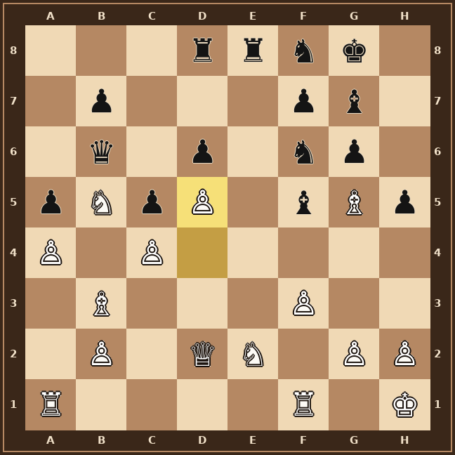

### Hello there! 👋

YouTube creator | Chess player | Gamer | Tech enthusiast

<!-- YT_STATS_START -->
  
<!-- YT_STATS_END -->

---

<!-- CHESS_START -->
### ♟️ Play chess with me!
*It's **me vs. the whole world**, team up with other visitors to outsmart me and claim a win for the guests!*

⬛ **@Krzys3n's turn (Black — top).** Restricted to the profile owner.

**Series score:** Krzys3n **1** : **0** Guests *(Draws: 0)*

#### 🎯 Choose a move (FROM → TO)

| FROM | TO - click a move |
| :---: | :--- |
| **B6** | [C7](https://github.com/Krzys3n/Krzys3n/issues/new?title=chess%3A%20b6c7&body=Chess%20move%3A%20%60b6c7%60%0A%0AClick%20%2A%2ACreate%20new%20issue%2A%2A%20to%20play%20this%20move.), [A7](https://github.com/Krzys3n/Krzys3n/issues/new?title=chess%3A%20b6a7&body=Chess%20move%3A%20%60b6a7%60%0A%0AClick%20%2A%2ACreate%20new%20issue%2A%2A%20to%20play%20this%20move.), [C6](https://github.com/Krzys3n/Krzys3n/issues/new?title=chess%3A%20b6c6&body=Chess%20move%3A%20%60b6c6%60%0A%0AClick%20%2A%2ACreate%20new%20issue%2A%2A%20to%20play%20this%20move.), [A6](https://github.com/Krzys3n/Krzys3n/issues/new?title=chess%3A%20b6a6&body=Chess%20move%3A%20%60b6a6%60%0A%0AClick%20%2A%2ACreate%20new%20issue%2A%2A%20to%20play%20this%20move.), [B5](https://github.com/Krzys3n/Krzys3n/issues/new?title=chess%3A%20b6b5&body=Chess%20move%3A%20%60b6b5%60%0A%0AClick%20%2A%2ACreate%20new%20issue%2A%2A%20to%20play%20this%20move.) |
| **D8** | [C8](https://github.com/Krzys3n/Krzys3n/issues/new?title=chess%3A%20d8c8&body=Chess%20move%3A%20%60d8c8%60%0A%0AClick%20%2A%2ACreate%20new%20issue%2A%2A%20to%20play%20this%20move.), [B8](https://github.com/Krzys3n/Krzys3n/issues/new?title=chess%3A%20d8b8&body=Chess%20move%3A%20%60d8b8%60%0A%0AClick%20%2A%2ACreate%20new%20issue%2A%2A%20to%20play%20this%20move.), [A8](https://github.com/Krzys3n/Krzys3n/issues/new?title=chess%3A%20d8a8&body=Chess%20move%3A%20%60d8a8%60%0A%0AClick%20%2A%2ACreate%20new%20issue%2A%2A%20to%20play%20this%20move.), [D7](https://github.com/Krzys3n/Krzys3n/issues/new?title=chess%3A%20d8d7&body=Chess%20move%3A%20%60d8d7%60%0A%0AClick%20%2A%2ACreate%20new%20issue%2A%2A%20to%20play%20this%20move.) |
| **E8** | [E7](https://github.com/Krzys3n/Krzys3n/issues/new?title=chess%3A%20e8e7&body=Chess%20move%3A%20%60e8e7%60%0A%0AClick%20%2A%2ACreate%20new%20issue%2A%2A%20to%20play%20this%20move.), [E6](https://github.com/Krzys3n/Krzys3n/issues/new?title=chess%3A%20e8e6&body=Chess%20move%3A%20%60e8e6%60%0A%0AClick%20%2A%2ACreate%20new%20issue%2A%2A%20to%20play%20this%20move.), [E5](https://github.com/Krzys3n/Krzys3n/issues/new?title=chess%3A%20e8e5&body=Chess%20move%3A%20%60e8e5%60%0A%0AClick%20%2A%2ACreate%20new%20issue%2A%2A%20to%20play%20this%20move.), [E4](https://github.com/Krzys3n/Krzys3n/issues/new?title=chess%3A%20e8e4&body=Chess%20move%3A%20%60e8e4%60%0A%0AClick%20%2A%2ACreate%20new%20issue%2A%2A%20to%20play%20this%20move.), [E3](https://github.com/Krzys3n/Krzys3n/issues/new?title=chess%3A%20e8e3&body=Chess%20move%3A%20%60e8e3%60%0A%0AClick%20%2A%2ACreate%20new%20issue%2A%2A%20to%20play%20this%20move.), [E2](https://github.com/Krzys3n/Krzys3n/issues/new?title=chess%3A%20e8e2&body=Chess%20move%3A%20%60e8e2%60%0A%0AClick%20%2A%2ACreate%20new%20issue%2A%2A%20to%20play%20this%20move.) |
| **F5** | [C8](https://github.com/Krzys3n/Krzys3n/issues/new?title=chess%3A%20f5c8&body=Chess%20move%3A%20%60f5c8%60%0A%0AClick%20%2A%2ACreate%20new%20issue%2A%2A%20to%20play%20this%20move.), [D7](https://github.com/Krzys3n/Krzys3n/issues/new?title=chess%3A%20f5d7&body=Chess%20move%3A%20%60f5d7%60%0A%0AClick%20%2A%2ACreate%20new%20issue%2A%2A%20to%20play%20this%20move.), [E6](https://github.com/Krzys3n/Krzys3n/issues/new?title=chess%3A%20f5e6&body=Chess%20move%3A%20%60f5e6%60%0A%0AClick%20%2A%2ACreate%20new%20issue%2A%2A%20to%20play%20this%20move.), [G4](https://github.com/Krzys3n/Krzys3n/issues/new?title=chess%3A%20f5g4&body=Chess%20move%3A%20%60f5g4%60%0A%0AClick%20%2A%2ACreate%20new%20issue%2A%2A%20to%20play%20this%20move.), [E4](https://github.com/Krzys3n/Krzys3n/issues/new?title=chess%3A%20f5e4&body=Chess%20move%3A%20%60f5e4%60%0A%0AClick%20%2A%2ACreate%20new%20issue%2A%2A%20to%20play%20this%20move.), [H3](https://github.com/Krzys3n/Krzys3n/issues/new?title=chess%3A%20f5h3&body=Chess%20move%3A%20%60f5h3%60%0A%0AClick%20%2A%2ACreate%20new%20issue%2A%2A%20to%20play%20this%20move.), [D3](https://github.com/Krzys3n/Krzys3n/issues/new?title=chess%3A%20f5d3&body=Chess%20move%3A%20%60f5d3%60%0A%0AClick%20%2A%2ACreate%20new%20issue%2A%2A%20to%20play%20this%20move.), [C2](https://github.com/Krzys3n/Krzys3n/issues/new?title=chess%3A%20f5c2&body=Chess%20move%3A%20%60f5c2%60%0A%0AClick%20%2A%2ACreate%20new%20issue%2A%2A%20to%20play%20this%20move.), [B1](https://github.com/Krzys3n/Krzys3n/issues/new?title=chess%3A%20f5b1&body=Chess%20move%3A%20%60f5b1%60%0A%0AClick%20%2A%2ACreate%20new%20issue%2A%2A%20to%20play%20this%20move.) |
| **F6** | [H7](https://github.com/Krzys3n/Krzys3n/issues/new?title=chess%3A%20f6h7&body=Chess%20move%3A%20%60f6h7%60%0A%0AClick%20%2A%2ACreate%20new%20issue%2A%2A%20to%20play%20this%20move.), [D7](https://github.com/Krzys3n/Krzys3n/issues/new?title=chess%3A%20f6d7&body=Chess%20move%3A%20%60f6d7%60%0A%0AClick%20%2A%2ACreate%20new%20issue%2A%2A%20to%20play%20this%20move.), [D5](https://github.com/Krzys3n/Krzys3n/issues/new?title=chess%3A%20f6d5&body=Chess%20move%3A%20%60f6d5%60%0A%0AClick%20%2A%2ACreate%20new%20issue%2A%2A%20to%20play%20this%20move.), [G4](https://github.com/Krzys3n/Krzys3n/issues/new?title=chess%3A%20f6g4&body=Chess%20move%3A%20%60f6g4%60%0A%0AClick%20%2A%2ACreate%20new%20issue%2A%2A%20to%20play%20this%20move.), [E4](https://github.com/Krzys3n/Krzys3n/issues/new?title=chess%3A%20f6e4&body=Chess%20move%3A%20%60f6e4%60%0A%0AClick%20%2A%2ACreate%20new%20issue%2A%2A%20to%20play%20this%20move.) |
| **F8** | [H7](https://github.com/Krzys3n/Krzys3n/issues/new?title=chess%3A%20f8h7&body=Chess%20move%3A%20%60f8h7%60%0A%0AClick%20%2A%2ACreate%20new%20issue%2A%2A%20to%20play%20this%20move.), [D7](https://github.com/Krzys3n/Krzys3n/issues/new?title=chess%3A%20f8d7&body=Chess%20move%3A%20%60f8d7%60%0A%0AClick%20%2A%2ACreate%20new%20issue%2A%2A%20to%20play%20this%20move.), [E6](https://github.com/Krzys3n/Krzys3n/issues/new?title=chess%3A%20f8e6&body=Chess%20move%3A%20%60f8e6%60%0A%0AClick%20%2A%2ACreate%20new%20issue%2A%2A%20to%20play%20this%20move.) |
| **G7** | [H8](https://github.com/Krzys3n/Krzys3n/issues/new?title=chess%3A%20g7h8&body=Chess%20move%3A%20%60g7h8%60%0A%0AClick%20%2A%2ACreate%20new%20issue%2A%2A%20to%20play%20this%20move.), [H6](https://github.com/Krzys3n/Krzys3n/issues/new?title=chess%3A%20g7h6&body=Chess%20move%3A%20%60g7h6%60%0A%0AClick%20%2A%2ACreate%20new%20issue%2A%2A%20to%20play%20this%20move.) |
| **G8** | [H8](https://github.com/Krzys3n/Krzys3n/issues/new?title=chess%3A%20g8h8&body=Chess%20move%3A%20%60g8h8%60%0A%0AClick%20%2A%2ACreate%20new%20issue%2A%2A%20to%20play%20this%20move.), [H7](https://github.com/Krzys3n/Krzys3n/issues/new?title=chess%3A%20g8h7&body=Chess%20move%3A%20%60g8h7%60%0A%0AClick%20%2A%2ACreate%20new%20issue%2A%2A%20to%20play%20this%20move.) |
| **H5** | [H4](https://github.com/Krzys3n/Krzys3n/issues/new?title=chess%3A%20h5h4&body=Chess%20move%3A%20%60h5h4%60%0A%0AClick%20%2A%2ACreate%20new%20issue%2A%2A%20to%20play%20this%20move.) |

**Surrender votes (0)** [🏳️ Vote to surrender](https://github.com/Krzys3n/Krzys3n/issues/new?title=chess%3A%20surrender&body=Vote%20to%20surrender%20the%20current%20game.%0A%0AClick%20%2A%2ACreate%20new%20issue%2A%2A%20to%20submit%20your%20vote.)  
*If you feel that the position is lost, you can vote to surrender. If I see two votes in a row, I will reset the board and mark it as a win.*

#### How to play
Click a move link in **FROM → TO** to open a pre-filled Issue, then click **Create new issue**. GitHub Actions validates the move, updates the board, and closes the Issue. *(Inspired by [timburgan](https://github.com/timburgan)).*

#### 🤝 Fair play & community
Feel free to share my profile with friends who know the rules of chess and team up with them to find the best move! As a gentleman's agreement, **no chess engines** I play my moves on my own, and you play yours with pure human brainpower.

#### Last few moves

| Move | Who |
| :--- | :--- |
| D4 to D5 | [@roscoe-sincero-sys](https://github.com/roscoe-sincero-sys) |
| D7 to F8 | [@Krzys3n](https://github.com/Krzys3n) |
| D1 to D2 | [@Nlxtz](https://github.com/Nlxtz) |
| A8 to D8 | [@Krzys3n](https://github.com/Krzys3n) |
| G1 to H1 | [@Nlxtz](https://github.com/Nlxtz) |

#### Guest Leaderboard

| Moves | Guest |
| :---: | :--- |
| 23 | [@Mniok](https://github.com/Mniok) |
| 9 | [@Nlxtz](https://github.com/Nlxtz) |
| 1 | [@jbuczkowski-naoko](https://github.com/jbuczkowski-naoko) |
| 1 | [@quetzelcoatlus](https://github.com/quetzelcoatlus) |
| 1 | [@roscoe-sincero-sys](https://github.com/roscoe-sincero-sys) |
| 1 | [@Shiro99x](https://github.com/Shiro99x) |
| 1 | [@uriel346as](https://github.com/uriel346as) |
| 1 | [@Zafkieli](https://github.com/Zafkieli) |

📜 *Past games history (PGN & stats) will be saved [here](https://github.com/Krzys3n/Krzys3n/tree/main/chess_games/history).*
<!-- CHESS_END -->
