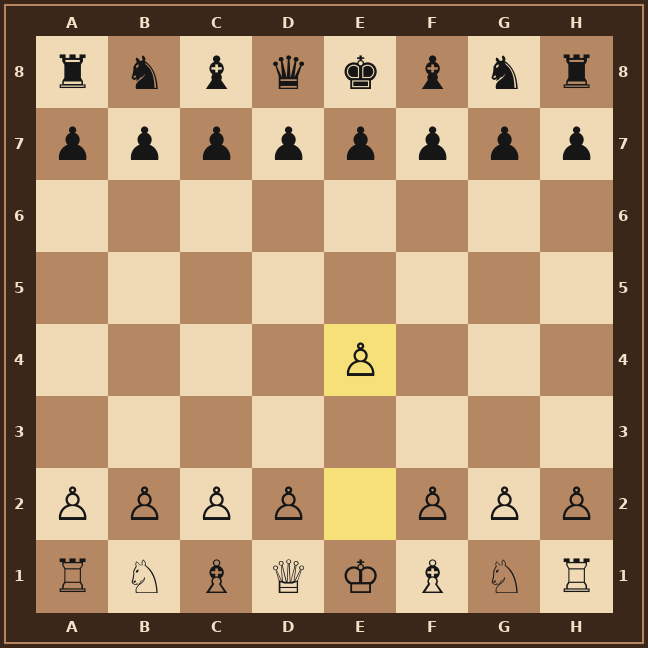

### Hello there! 👋

YouTube creator | Chess player | Gamer | Tech enthusiast

<!-- YT_STATS_START -->
  
<!-- YT_STATS_END -->

---

<!-- CHESS_START -->
### ♟️ Play chess with me!

⬛ **@Krzys3n's turn (Black — top).** Restricted to the profile owner.

**Series score:** Krzys3n **0** : **0** Guests *(Draws: 0)*

#### 🎯 Choose a move (FROM → TO)

| FROM | TO - click a move |
| :---: | :--- |
| **A7** | [A6](https://github.com/Krzys3n/Krzys3n/issues/new?title=chess%3A%20a7a6&body=Chess%20move%3A%20%60a7a6%60%0A%0AClick%20%2A%2ACreate%20new%20issue%2A%2A%20to%20play%20this%20move.), [A5](https://github.com/Krzys3n/Krzys3n/issues/new?title=chess%3A%20a7a5&body=Chess%20move%3A%20%60a7a5%60%0A%0AClick%20%2A%2ACreate%20new%20issue%2A%2A%20to%20play%20this%20move.) |
| **B7** | [B6](https://github.com/Krzys3n/Krzys3n/issues/new?title=chess%3A%20b7b6&body=Chess%20move%3A%20%60b7b6%60%0A%0AClick%20%2A%2ACreate%20new%20issue%2A%2A%20to%20play%20this%20move.), [B5](https://github.com/Krzys3n/Krzys3n/issues/new?title=chess%3A%20b7b5&body=Chess%20move%3A%20%60b7b5%60%0A%0AClick%20%2A%2ACreate%20new%20issue%2A%2A%20to%20play%20this%20move.) |
| **B8** | [C6](https://github.com/Krzys3n/Krzys3n/issues/new?title=chess%3A%20b8c6&body=Chess%20move%3A%20%60b8c6%60%0A%0AClick%20%2A%2ACreate%20new%20issue%2A%2A%20to%20play%20this%20move.), [A6](https://github.com/Krzys3n/Krzys3n/issues/new?title=chess%3A%20b8a6&body=Chess%20move%3A%20%60b8a6%60%0A%0AClick%20%2A%2ACreate%20new%20issue%2A%2A%20to%20play%20this%20move.) |
| **C7** | [C6](https://github.com/Krzys3n/Krzys3n/issues/new?title=chess%3A%20c7c6&body=Chess%20move%3A%20%60c7c6%60%0A%0AClick%20%2A%2ACreate%20new%20issue%2A%2A%20to%20play%20this%20move.), [C5](https://github.com/Krzys3n/Krzys3n/issues/new?title=chess%3A%20c7c5&body=Chess%20move%3A%20%60c7c5%60%0A%0AClick%20%2A%2ACreate%20new%20issue%2A%2A%20to%20play%20this%20move.) |
| **D7** | [D6](https://github.com/Krzys3n/Krzys3n/issues/new?title=chess%3A%20d7d6&body=Chess%20move%3A%20%60d7d6%60%0A%0AClick%20%2A%2ACreate%20new%20issue%2A%2A%20to%20play%20this%20move.), [D5](https://github.com/Krzys3n/Krzys3n/issues/new?title=chess%3A%20d7d5&body=Chess%20move%3A%20%60d7d5%60%0A%0AClick%20%2A%2ACreate%20new%20issue%2A%2A%20to%20play%20this%20move.) |
| **E7** | [E6](https://github.com/Krzys3n/Krzys3n/issues/new?title=chess%3A%20e7e6&body=Chess%20move%3A%20%60e7e6%60%0A%0AClick%20%2A%2ACreate%20new%20issue%2A%2A%20to%20play%20this%20move.), [E5](https://github.com/Krzys3n/Krzys3n/issues/new?title=chess%3A%20e7e5&body=Chess%20move%3A%20%60e7e5%60%0A%0AClick%20%2A%2ACreate%20new%20issue%2A%2A%20to%20play%20this%20move.) |
| **F7** | [F6](https://github.com/Krzys3n/Krzys3n/issues/new?title=chess%3A%20f7f6&body=Chess%20move%3A%20%60f7f6%60%0A%0AClick%20%2A%2ACreate%20new%20issue%2A%2A%20to%20play%20this%20move.), [F5](https://github.com/Krzys3n/Krzys3n/issues/new?title=chess%3A%20f7f5&body=Chess%20move%3A%20%60f7f5%60%0A%0AClick%20%2A%2ACreate%20new%20issue%2A%2A%20to%20play%20this%20move.) |
| **G7** | [G6](https://github.com/Krzys3n/Krzys3n/issues/new?title=chess%3A%20g7g6&body=Chess%20move%3A%20%60g7g6%60%0A%0AClick%20%2A%2ACreate%20new%20issue%2A%2A%20to%20play%20this%20move.), [G5](https://github.com/Krzys3n/Krzys3n/issues/new?title=chess%3A%20g7g5&body=Chess%20move%3A%20%60g7g5%60%0A%0AClick%20%2A%2ACreate%20new%20issue%2A%2A%20to%20play%20this%20move.) |
| **G8** | [H6](https://github.com/Krzys3n/Krzys3n/issues/new?title=chess%3A%20g8h6&body=Chess%20move%3A%20%60g8h6%60%0A%0AClick%20%2A%2ACreate%20new%20issue%2A%2A%20to%20play%20this%20move.), [F6](https://github.com/Krzys3n/Krzys3n/issues/new?title=chess%3A%20g8f6&body=Chess%20move%3A%20%60g8f6%60%0A%0AClick%20%2A%2ACreate%20new%20issue%2A%2A%20to%20play%20this%20move.) |
| **H7** | [H6](https://github.com/Krzys3n/Krzys3n/issues/new?title=chess%3A%20h7h6&body=Chess%20move%3A%20%60h7h6%60%0A%0AClick%20%2A%2ACreate%20new%20issue%2A%2A%20to%20play%20this%20move.), [H5](https://github.com/Krzys3n/Krzys3n/issues/new?title=chess%3A%20h7h5&body=Chess%20move%3A%20%60h7h5%60%0A%0AClick%20%2A%2ACreate%20new%20issue%2A%2A%20to%20play%20this%20move.) |

#### How to play
Click a move link in **FROM → TO** to open a pre-filled Issue, then click **Create new issue**. GitHub Actions validates the move, updates the board, and closes the Issue. *(Inspired by [timburgan](https://github.com/timburgan)).*

#### Last few moves

| Move | Who |
| :--- | :--- |
| E2 to E4 | @Mniok |

#### Guest Leaderboard

| Moves | Guest |
| :---: | :--- |
| 1 | @Mniok |
<!-- CHESS_END -->
