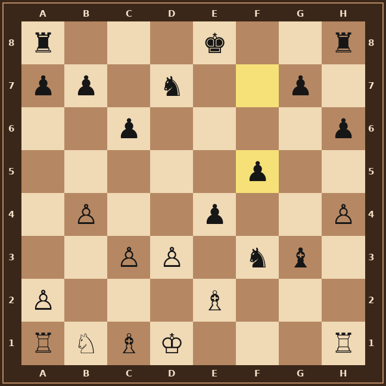

### Hello there! 👋

YouTube creator | Chess player | Gamer | Tech enthusiast

<!-- YT_STATS_START -->
  
<!-- YT_STATS_END -->

---

<!-- CHESS_START -->
### ♟️ Play chess with me!
*It's **me vs. the whole world**, team up with other visitors to outsmart me and claim a win for the guests!*

⬜ **Your turn! Play White (bottom).** Any guest can make the next move.

**Series score:** Krzys3n **0** : **0** Guests *(Draws: 0)*

#### 🎯 Choose a move (FROM → TO)

| FROM | TO - click a move |
| :---: | :--- |
| **A2** | [A3](https://github.com/Krzys3n/Krzys3n/issues/new?title=chess%3A%20a2a3&body=Chess%20move%3A%20%60a2a3%60%0A%0AClick%20%2A%2ACreate%20new%20issue%2A%2A%20to%20play%20this%20move.), [A4](https://github.com/Krzys3n/Krzys3n/issues/new?title=chess%3A%20a2a4&body=Chess%20move%3A%20%60a2a4%60%0A%0AClick%20%2A%2ACreate%20new%20issue%2A%2A%20to%20play%20this%20move.) |
| **B1** | [A3](https://github.com/Krzys3n/Krzys3n/issues/new?title=chess%3A%20b1a3&body=Chess%20move%3A%20%60b1a3%60%0A%0AClick%20%2A%2ACreate%20new%20issue%2A%2A%20to%20play%20this%20move.), [D2](https://github.com/Krzys3n/Krzys3n/issues/new?title=chess%3A%20b1d2&body=Chess%20move%3A%20%60b1d2%60%0A%0AClick%20%2A%2ACreate%20new%20issue%2A%2A%20to%20play%20this%20move.) |
| **B4** | [B5](https://github.com/Krzys3n/Krzys3n/issues/new?title=chess%3A%20b4b5&body=Chess%20move%3A%20%60b4b5%60%0A%0AClick%20%2A%2ACreate%20new%20issue%2A%2A%20to%20play%20this%20move.) |
| **C1** | [H6](https://github.com/Krzys3n/Krzys3n/issues/new?title=chess%3A%20c1h6&body=Chess%20move%3A%20%60c1h6%60%0A%0AClick%20%2A%2ACreate%20new%20issue%2A%2A%20to%20play%20this%20move.), [G5](https://github.com/Krzys3n/Krzys3n/issues/new?title=chess%3A%20c1g5&body=Chess%20move%3A%20%60c1g5%60%0A%0AClick%20%2A%2ACreate%20new%20issue%2A%2A%20to%20play%20this%20move.), [F4](https://github.com/Krzys3n/Krzys3n/issues/new?title=chess%3A%20c1f4&body=Chess%20move%3A%20%60c1f4%60%0A%0AClick%20%2A%2ACreate%20new%20issue%2A%2A%20to%20play%20this%20move.), [E3](https://github.com/Krzys3n/Krzys3n/issues/new?title=chess%3A%20c1e3&body=Chess%20move%3A%20%60c1e3%60%0A%0AClick%20%2A%2ACreate%20new%20issue%2A%2A%20to%20play%20this%20move.), [A3](https://github.com/Krzys3n/Krzys3n/issues/new?title=chess%3A%20c1a3&body=Chess%20move%3A%20%60c1a3%60%0A%0AClick%20%2A%2ACreate%20new%20issue%2A%2A%20to%20play%20this%20move.), [D2](https://github.com/Krzys3n/Krzys3n/issues/new?title=chess%3A%20c1d2&body=Chess%20move%3A%20%60c1d2%60%0A%0AClick%20%2A%2ACreate%20new%20issue%2A%2A%20to%20play%20this%20move.), [B2](https://github.com/Krzys3n/Krzys3n/issues/new?title=chess%3A%20c1b2&body=Chess%20move%3A%20%60c1b2%60%0A%0AClick%20%2A%2ACreate%20new%20issue%2A%2A%20to%20play%20this%20move.) |
| **C3** | [C4](https://github.com/Krzys3n/Krzys3n/issues/new?title=chess%3A%20c3c4&body=Chess%20move%3A%20%60c3c4%60%0A%0AClick%20%2A%2ACreate%20new%20issue%2A%2A%20to%20play%20this%20move.) |
| **D1** | [C2](https://github.com/Krzys3n/Krzys3n/issues/new?title=chess%3A%20d1c2&body=Chess%20move%3A%20%60d1c2%60%0A%0AClick%20%2A%2ACreate%20new%20issue%2A%2A%20to%20play%20this%20move.) |
| **D3** | [E4](https://github.com/Krzys3n/Krzys3n/issues/new?title=chess%3A%20d3e4&body=Chess%20move%3A%20%60d3e4%60%0A%0AClick%20%2A%2ACreate%20new%20issue%2A%2A%20to%20play%20this%20move.), [D4](https://github.com/Krzys3n/Krzys3n/issues/new?title=chess%3A%20d3d4&body=Chess%20move%3A%20%60d3d4%60%0A%0AClick%20%2A%2ACreate%20new%20issue%2A%2A%20to%20play%20this%20move.) |
| **E2** | [F3](https://github.com/Krzys3n/Krzys3n/issues/new?title=chess%3A%20e2f3&body=Chess%20move%3A%20%60e2f3%60%0A%0AClick%20%2A%2ACreate%20new%20issue%2A%2A%20to%20play%20this%20move.), [F1](https://github.com/Krzys3n/Krzys3n/issues/new?title=chess%3A%20e2f1&body=Chess%20move%3A%20%60e2f1%60%0A%0AClick%20%2A%2ACreate%20new%20issue%2A%2A%20to%20play%20this%20move.) |
| **H1** | [H3](https://github.com/Krzys3n/Krzys3n/issues/new?title=chess%3A%20h1h3&body=Chess%20move%3A%20%60h1h3%60%0A%0AClick%20%2A%2ACreate%20new%20issue%2A%2A%20to%20play%20this%20move.), [H2](https://github.com/Krzys3n/Krzys3n/issues/new?title=chess%3A%20h1h2&body=Chess%20move%3A%20%60h1h2%60%0A%0AClick%20%2A%2ACreate%20new%20issue%2A%2A%20to%20play%20this%20move.), [G1](https://github.com/Krzys3n/Krzys3n/issues/new?title=chess%3A%20h1g1&body=Chess%20move%3A%20%60h1g1%60%0A%0AClick%20%2A%2ACreate%20new%20issue%2A%2A%20to%20play%20this%20move.), [F1](https://github.com/Krzys3n/Krzys3n/issues/new?title=chess%3A%20h1f1&body=Chess%20move%3A%20%60h1f1%60%0A%0AClick%20%2A%2ACreate%20new%20issue%2A%2A%20to%20play%20this%20move.), [E1](https://github.com/Krzys3n/Krzys3n/issues/new?title=chess%3A%20h1e1&body=Chess%20move%3A%20%60h1e1%60%0A%0AClick%20%2A%2ACreate%20new%20issue%2A%2A%20to%20play%20this%20move.) |
| **H4** | [H5](https://github.com/Krzys3n/Krzys3n/issues/new?title=chess%3A%20h4h5&body=Chess%20move%3A%20%60h4h5%60%0A%0AClick%20%2A%2ACreate%20new%20issue%2A%2A%20to%20play%20this%20move.) |

**Surrender votes (1)** [🏳️ Vote to surrender](https://github.com/Krzys3n/Krzys3n/issues/new?title=chess%3A%20surrender&body=Vote%20to%20surrender%20the%20current%20game.%0A%0AClick%20%2A%2ACreate%20new%20issue%2A%2A%20to%20submit%20your%20vote.)  
*If you feel that the position is lost, you can vote to surrender. If I see two votes in a row, I will reset the board and mark it as a win.*

#### How to play
Click a move link in **FROM → TO** to open a pre-filled Issue, then click **Create new issue**. GitHub Actions validates the move, updates the board, and closes the Issue. *(Inspired by [timburgan](https://github.com/timburgan)).*

#### 🤝 Fair play & community
Feel free to share my profile with friends who know the rules of chess and team up with them to find the best move! As a gentleman's agreement, **no chess engines** I play my moves on my own, and you play yours with pure human brainpower.

#### Last few moves

| Move | Who |
| :--- | :--- |
| F7 to F5 | [@Krzys3n](https://github.com/Krzys3n) |
| D2 to D3 | [@Mniok](https://github.com/Mniok) |
| G5 to F3 | [@Krzys3n](https://github.com/Krzys3n) |
| E1 to D1 | [@Mniok](https://github.com/Mniok) |
| D6 to G3 | [@Krzys3n](https://github.com/Krzys3n) |

#### Guest Leaderboard

| Moves | Guest |
| :---: | :--- |
| 14 | [@Mniok](https://github.com/Mniok) |
| 1 | [@Shiro99x](https://github.com/Shiro99x) |
| 1 | [@uriel346as](https://github.com/uriel346as) |
| 1 | [@Zafkieli](https://github.com/Zafkieli) |

📜 *Past games history (PGN & stats) will be saved [here](https://github.com/Krzys3n/Krzys3n/tree/main/chess_games/history).*
<!-- CHESS_END -->
