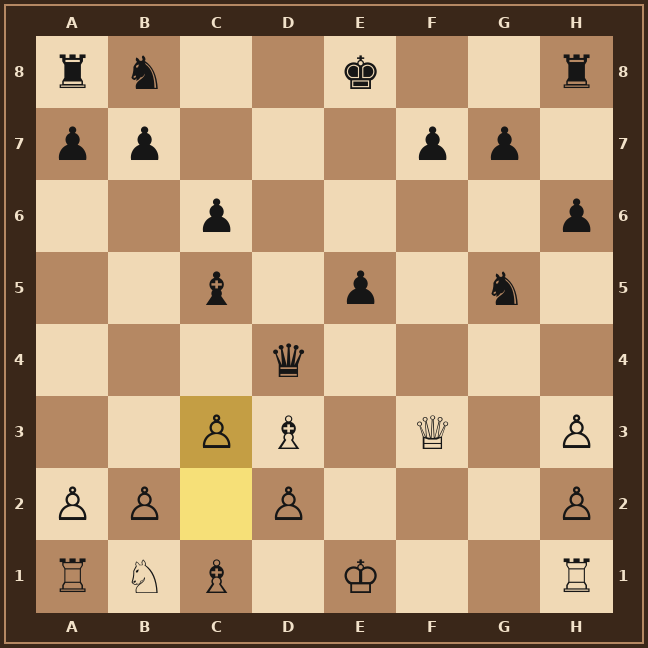

### Hello there! 👋

YouTube creator | Chess player | Gamer | Tech enthusiast

<!-- YT_STATS_START -->
  
<!-- YT_STATS_END -->

---

<!-- CHESS_START -->
### ♟️ Play chess with me!

⬛ **@Krzys3n's turn (Black — top).** Restricted to the profile owner.

**Series score:** Krzys3n **0** : **0** Guests *(Draws: 0)*

#### 🎯 Choose a move (FROM → TO)

| FROM | TO - click a move |
| :---: | :--- |
| **A7** | [A6](https://github.com/Krzys3n/Krzys3n/issues/new?title=chess%3A%20a7a6&body=Chess%20move%3A%20%60a7a6%60%0A%0AClick%20%2A%2ACreate%20new%20issue%2A%2A%20to%20play%20this%20move.), [A5](https://github.com/Krzys3n/Krzys3n/issues/new?title=chess%3A%20a7a5&body=Chess%20move%3A%20%60a7a5%60%0A%0AClick%20%2A%2ACreate%20new%20issue%2A%2A%20to%20play%20this%20move.) |
| **B7** | [B6](https://github.com/Krzys3n/Krzys3n/issues/new?title=chess%3A%20b7b6&body=Chess%20move%3A%20%60b7b6%60%0A%0AClick%20%2A%2ACreate%20new%20issue%2A%2A%20to%20play%20this%20move.), [B5](https://github.com/Krzys3n/Krzys3n/issues/new?title=chess%3A%20b7b5&body=Chess%20move%3A%20%60b7b5%60%0A%0AClick%20%2A%2ACreate%20new%20issue%2A%2A%20to%20play%20this%20move.) |
| **B8** | [D7](https://github.com/Krzys3n/Krzys3n/issues/new?title=chess%3A%20b8d7&body=Chess%20move%3A%20%60b8d7%60%0A%0AClick%20%2A%2ACreate%20new%20issue%2A%2A%20to%20play%20this%20move.), [A6](https://github.com/Krzys3n/Krzys3n/issues/new?title=chess%3A%20b8a6&body=Chess%20move%3A%20%60b8a6%60%0A%0AClick%20%2A%2ACreate%20new%20issue%2A%2A%20to%20play%20this%20move.) |
| **C5** | [F8](https://github.com/Krzys3n/Krzys3n/issues/new?title=chess%3A%20c5f8&body=Chess%20move%3A%20%60c5f8%60%0A%0AClick%20%2A%2ACreate%20new%20issue%2A%2A%20to%20play%20this%20move.), [E7](https://github.com/Krzys3n/Krzys3n/issues/new?title=chess%3A%20c5e7&body=Chess%20move%3A%20%60c5e7%60%0A%0AClick%20%2A%2ACreate%20new%20issue%2A%2A%20to%20play%20this%20move.), [D6](https://github.com/Krzys3n/Krzys3n/issues/new?title=chess%3A%20c5d6&body=Chess%20move%3A%20%60c5d6%60%0A%0AClick%20%2A%2ACreate%20new%20issue%2A%2A%20to%20play%20this%20move.), [B6](https://github.com/Krzys3n/Krzys3n/issues/new?title=chess%3A%20c5b6&body=Chess%20move%3A%20%60c5b6%60%0A%0AClick%20%2A%2ACreate%20new%20issue%2A%2A%20to%20play%20this%20move.), [B4](https://github.com/Krzys3n/Krzys3n/issues/new?title=chess%3A%20c5b4&body=Chess%20move%3A%20%60c5b4%60%0A%0AClick%20%2A%2ACreate%20new%20issue%2A%2A%20to%20play%20this%20move.), [A3](https://github.com/Krzys3n/Krzys3n/issues/new?title=chess%3A%20c5a3&body=Chess%20move%3A%20%60c5a3%60%0A%0AClick%20%2A%2ACreate%20new%20issue%2A%2A%20to%20play%20this%20move.) |
| **D4** | [D8](https://github.com/Krzys3n/Krzys3n/issues/new?title=chess%3A%20d4d8&body=Chess%20move%3A%20%60d4d8%60%0A%0AClick%20%2A%2ACreate%20new%20issue%2A%2A%20to%20play%20this%20move.), [D7](https://github.com/Krzys3n/Krzys3n/issues/new?title=chess%3A%20d4d7&body=Chess%20move%3A%20%60d4d7%60%0A%0AClick%20%2A%2ACreate%20new%20issue%2A%2A%20to%20play%20this%20move.), [D6](https://github.com/Krzys3n/Krzys3n/issues/new?title=chess%3A%20d4d6&body=Chess%20move%3A%20%60d4d6%60%0A%0AClick%20%2A%2ACreate%20new%20issue%2A%2A%20to%20play%20this%20move.), [D5](https://github.com/Krzys3n/Krzys3n/issues/new?title=chess%3A%20d4d5&body=Chess%20move%3A%20%60d4d5%60%0A%0AClick%20%2A%2ACreate%20new%20issue%2A%2A%20to%20play%20this%20move.), [H4](https://github.com/Krzys3n/Krzys3n/issues/new?title=chess%3A%20d4h4&body=Chess%20move%3A%20%60d4h4%60%0A%0AClick%20%2A%2ACreate%20new%20issue%2A%2A%20to%20play%20this%20move.), [G4](https://github.com/Krzys3n/Krzys3n/issues/new?title=chess%3A%20d4g4&body=Chess%20move%3A%20%60d4g4%60%0A%0AClick%20%2A%2ACreate%20new%20issue%2A%2A%20to%20play%20this%20move.), [F4](https://github.com/Krzys3n/Krzys3n/issues/new?title=chess%3A%20d4f4&body=Chess%20move%3A%20%60d4f4%60%0A%0AClick%20%2A%2ACreate%20new%20issue%2A%2A%20to%20play%20this%20move.), [E4](https://github.com/Krzys3n/Krzys3n/issues/new?title=chess%3A%20d4e4&body=Chess%20move%3A%20%60d4e4%60%0A%0AClick%20%2A%2ACreate%20new%20issue%2A%2A%20to%20play%20this%20move.), [C4](https://github.com/Krzys3n/Krzys3n/issues/new?title=chess%3A%20d4c4&body=Chess%20move%3A%20%60d4c4%60%0A%0AClick%20%2A%2ACreate%20new%20issue%2A%2A%20to%20play%20this%20move.), [B4](https://github.com/Krzys3n/Krzys3n/issues/new?title=chess%3A%20d4b4&body=Chess%20move%3A%20%60d4b4%60%0A%0AClick%20%2A%2ACreate%20new%20issue%2A%2A%20to%20play%20this%20move.), [A4](https://github.com/Krzys3n/Krzys3n/issues/new?title=chess%3A%20d4a4&body=Chess%20move%3A%20%60d4a4%60%0A%0AClick%20%2A%2ACreate%20new%20issue%2A%2A%20to%20play%20this%20move.), [E3](https://github.com/Krzys3n/Krzys3n/issues/new?title=chess%3A%20d4e3&body=Chess%20move%3A%20%60d4e3%60%0A%0AClick%20%2A%2ACreate%20new%20issue%2A%2A%20to%20play%20this%20move.), [D3](https://github.com/Krzys3n/Krzys3n/issues/new?title=chess%3A%20d4d3&body=Chess%20move%3A%20%60d4d3%60%0A%0AClick%20%2A%2ACreate%20new%20issue%2A%2A%20to%20play%20this%20move.), [C3](https://github.com/Krzys3n/Krzys3n/issues/new?title=chess%3A%20d4c3&body=Chess%20move%3A%20%60d4c3%60%0A%0AClick%20%2A%2ACreate%20new%20issue%2A%2A%20to%20play%20this%20move.), [F2](https://github.com/Krzys3n/Krzys3n/issues/new?title=chess%3A%20d4f2&body=Chess%20move%3A%20%60d4f2%60%0A%0AClick%20%2A%2ACreate%20new%20issue%2A%2A%20to%20play%20this%20move.), [G1](https://github.com/Krzys3n/Krzys3n/issues/new?title=chess%3A%20d4g1&body=Chess%20move%3A%20%60d4g1%60%0A%0AClick%20%2A%2ACreate%20new%20issue%2A%2A%20to%20play%20this%20move.) |
| **E5** | [E4](https://github.com/Krzys3n/Krzys3n/issues/new?title=chess%3A%20e5e4&body=Chess%20move%3A%20%60e5e4%60%0A%0AClick%20%2A%2ACreate%20new%20issue%2A%2A%20to%20play%20this%20move.) |
| **E8** | [F8](https://github.com/Krzys3n/Krzys3n/issues/new?title=chess%3A%20e8f8&body=Chess%20move%3A%20%60e8f8%60%0A%0AClick%20%2A%2ACreate%20new%20issue%2A%2A%20to%20play%20this%20move.), [D8](https://github.com/Krzys3n/Krzys3n/issues/new?title=chess%3A%20e8d8&body=Chess%20move%3A%20%60e8d8%60%0A%0AClick%20%2A%2ACreate%20new%20issue%2A%2A%20to%20play%20this%20move.), [E7](https://github.com/Krzys3n/Krzys3n/issues/new?title=chess%3A%20e8e7&body=Chess%20move%3A%20%60e8e7%60%0A%0AClick%20%2A%2ACreate%20new%20issue%2A%2A%20to%20play%20this%20move.), [D7](https://github.com/Krzys3n/Krzys3n/issues/new?title=chess%3A%20e8d7&body=Chess%20move%3A%20%60e8d7%60%0A%0AClick%20%2A%2ACreate%20new%20issue%2A%2A%20to%20play%20this%20move.), [G8](https://github.com/Krzys3n/Krzys3n/issues/new?title=chess%3A%20e8g8&body=Chess%20move%3A%20%60e8g8%60%0A%0AClick%20%2A%2ACreate%20new%20issue%2A%2A%20to%20play%20this%20move.) |
| **F7** | [F6](https://github.com/Krzys3n/Krzys3n/issues/new?title=chess%3A%20f7f6&body=Chess%20move%3A%20%60f7f6%60%0A%0AClick%20%2A%2ACreate%20new%20issue%2A%2A%20to%20play%20this%20move.), [F5](https://github.com/Krzys3n/Krzys3n/issues/new?title=chess%3A%20f7f5&body=Chess%20move%3A%20%60f7f5%60%0A%0AClick%20%2A%2ACreate%20new%20issue%2A%2A%20to%20play%20this%20move.) |
| **G5** | [H7](https://github.com/Krzys3n/Krzys3n/issues/new?title=chess%3A%20g5h7&body=Chess%20move%3A%20%60g5h7%60%0A%0AClick%20%2A%2ACreate%20new%20issue%2A%2A%20to%20play%20this%20move.), [E6](https://github.com/Krzys3n/Krzys3n/issues/new?title=chess%3A%20g5e6&body=Chess%20move%3A%20%60g5e6%60%0A%0AClick%20%2A%2ACreate%20new%20issue%2A%2A%20to%20play%20this%20move.), [E4](https://github.com/Krzys3n/Krzys3n/issues/new?title=chess%3A%20g5e4&body=Chess%20move%3A%20%60g5e4%60%0A%0AClick%20%2A%2ACreate%20new%20issue%2A%2A%20to%20play%20this%20move.), [H3](https://github.com/Krzys3n/Krzys3n/issues/new?title=chess%3A%20g5h3&body=Chess%20move%3A%20%60g5h3%60%0A%0AClick%20%2A%2ACreate%20new%20issue%2A%2A%20to%20play%20this%20move.), [F3](https://github.com/Krzys3n/Krzys3n/issues/new?title=chess%3A%20g5f3&body=Chess%20move%3A%20%60g5f3%60%0A%0AClick%20%2A%2ACreate%20new%20issue%2A%2A%20to%20play%20this%20move.) |
| **G7** | [G6](https://github.com/Krzys3n/Krzys3n/issues/new?title=chess%3A%20g7g6&body=Chess%20move%3A%20%60g7g6%60%0A%0AClick%20%2A%2ACreate%20new%20issue%2A%2A%20to%20play%20this%20move.) |
| **H6** | [H5](https://github.com/Krzys3n/Krzys3n/issues/new?title=chess%3A%20h6h5&body=Chess%20move%3A%20%60h6h5%60%0A%0AClick%20%2A%2ACreate%20new%20issue%2A%2A%20to%20play%20this%20move.) |
| **H8** | [G8](https://github.com/Krzys3n/Krzys3n/issues/new?title=chess%3A%20h8g8&body=Chess%20move%3A%20%60h8g8%60%0A%0AClick%20%2A%2ACreate%20new%20issue%2A%2A%20to%20play%20this%20move.), [F8](https://github.com/Krzys3n/Krzys3n/issues/new?title=chess%3A%20h8f8&body=Chess%20move%3A%20%60h8f8%60%0A%0AClick%20%2A%2ACreate%20new%20issue%2A%2A%20to%20play%20this%20move.), [H7](https://github.com/Krzys3n/Krzys3n/issues/new?title=chess%3A%20h8h7&body=Chess%20move%3A%20%60h8h7%60%0A%0AClick%20%2A%2ACreate%20new%20issue%2A%2A%20to%20play%20this%20move.) |

**Surrender votes (1)** — [🏳️ Vote to surrender](https://github.com/Krzys3n/Krzys3n/issues/new?title=chess%3A%20surrender&body=Vote%20to%20surrender%20the%20current%20game.%0A%0AClick%20%2A%2ACreate%20new%20issue%2A%2A%20to%20submit%20your%20vote.)  
*If you feel that the position is lost, you can vote to surrender. If I see enough votes, I will reset the match and mark it as a win.*

#### How to play
Click a move link in **FROM → TO** to open a pre-filled Issue, then click **Create new issue**. GitHub Actions validates the move, updates the board, and closes the Issue. *(Inspired by [timburgan](https://github.com/timburgan)).*

#### Last few moves

| Move | Who |
| :--- | :--- |
| C2 to C3 | [@uriel346as](https://github.com/uriel346as) |
| E4 to G5 | [@Krzys3n](https://github.com/Krzys3n) |
| B5 to D3 | [@Zafkieli](https://github.com/Zafkieli) |
| C7 to C6 | [@Krzys3n](https://github.com/Krzys3n) |
| F1 to B5 | [@Mniok](https://github.com/Mniok) |

#### Guest Leaderboard

| Moves | Guest |
| :---: | :--- |
| 7 | [@Mniok](https://github.com/Mniok) |
| 1 | [@Shiro99x](https://github.com/Shiro99x) |
| 1 | [@uriel346as](https://github.com/uriel346as) |
| 1 | [@Zafkieli](https://github.com/Zafkieli) |
<!-- CHESS_END -->
