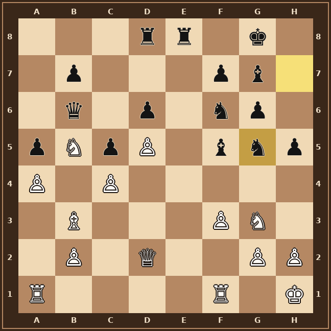

### Hello there! 👋

YouTube creator | Chess player | Gamer | Tech enthusiast

<!-- YT_STATS_START -->
  
<!-- YT_STATS_END -->

---

<!-- CHESS_START -->
### ♟️ Play chess with me!
*It's **me vs. the whole world**, team up with other visitors to outsmart me and claim a win for the guests!*

⬜ **Your turn! Play White (bottom).** Any guest can make the next move.

**Series score:** Krzys3n **1** : **0** Guests *(Draws: 0)*

#### 🎯 Choose a move (FROM → TO)

| FROM | TO - click a move |
| :---: | :--- |
| **A1** | [A3](https://github.com/Krzys3n/Krzys3n/issues/new?title=chess%3A%20a1a3&body=Chess%20move%3A%20%60a1a3%60%0A%0AClick%20%2A%2ACreate%20new%20issue%2A%2A%20to%20play%20this%20move.), [A2](https://github.com/Krzys3n/Krzys3n/issues/new?title=chess%3A%20a1a2&body=Chess%20move%3A%20%60a1a2%60%0A%0AClick%20%2A%2ACreate%20new%20issue%2A%2A%20to%20play%20this%20move.), [E1](https://github.com/Krzys3n/Krzys3n/issues/new?title=chess%3A%20a1e1&body=Chess%20move%3A%20%60a1e1%60%0A%0AClick%20%2A%2ACreate%20new%20issue%2A%2A%20to%20play%20this%20move.), [D1](https://github.com/Krzys3n/Krzys3n/issues/new?title=chess%3A%20a1d1&body=Chess%20move%3A%20%60a1d1%60%0A%0AClick%20%2A%2ACreate%20new%20issue%2A%2A%20to%20play%20this%20move.), [C1](https://github.com/Krzys3n/Krzys3n/issues/new?title=chess%3A%20a1c1&body=Chess%20move%3A%20%60a1c1%60%0A%0AClick%20%2A%2ACreate%20new%20issue%2A%2A%20to%20play%20this%20move.), [B1](https://github.com/Krzys3n/Krzys3n/issues/new?title=chess%3A%20a1b1&body=Chess%20move%3A%20%60a1b1%60%0A%0AClick%20%2A%2ACreate%20new%20issue%2A%2A%20to%20play%20this%20move.) |
| **B3** | [C2](https://github.com/Krzys3n/Krzys3n/issues/new?title=chess%3A%20b3c2&body=Chess%20move%3A%20%60b3c2%60%0A%0AClick%20%2A%2ACreate%20new%20issue%2A%2A%20to%20play%20this%20move.), [A2](https://github.com/Krzys3n/Krzys3n/issues/new?title=chess%3A%20b3a2&body=Chess%20move%3A%20%60b3a2%60%0A%0AClick%20%2A%2ACreate%20new%20issue%2A%2A%20to%20play%20this%20move.), [D1](https://github.com/Krzys3n/Krzys3n/issues/new?title=chess%3A%20b3d1&body=Chess%20move%3A%20%60b3d1%60%0A%0AClick%20%2A%2ACreate%20new%20issue%2A%2A%20to%20play%20this%20move.) |
| **B5** | [C7](https://github.com/Krzys3n/Krzys3n/issues/new?title=chess%3A%20b5c7&body=Chess%20move%3A%20%60b5c7%60%0A%0AClick%20%2A%2ACreate%20new%20issue%2A%2A%20to%20play%20this%20move.), [A7](https://github.com/Krzys3n/Krzys3n/issues/new?title=chess%3A%20b5a7&body=Chess%20move%3A%20%60b5a7%60%0A%0AClick%20%2A%2ACreate%20new%20issue%2A%2A%20to%20play%20this%20move.), [D6](https://github.com/Krzys3n/Krzys3n/issues/new?title=chess%3A%20b5d6&body=Chess%20move%3A%20%60b5d6%60%0A%0AClick%20%2A%2ACreate%20new%20issue%2A%2A%20to%20play%20this%20move.), [D4](https://github.com/Krzys3n/Krzys3n/issues/new?title=chess%3A%20b5d4&body=Chess%20move%3A%20%60b5d4%60%0A%0AClick%20%2A%2ACreate%20new%20issue%2A%2A%20to%20play%20this%20move.), [C3](https://github.com/Krzys3n/Krzys3n/issues/new?title=chess%3A%20b5c3&body=Chess%20move%3A%20%60b5c3%60%0A%0AClick%20%2A%2ACreate%20new%20issue%2A%2A%20to%20play%20this%20move.), [A3](https://github.com/Krzys3n/Krzys3n/issues/new?title=chess%3A%20b5a3&body=Chess%20move%3A%20%60b5a3%60%0A%0AClick%20%2A%2ACreate%20new%20issue%2A%2A%20to%20play%20this%20move.) |
| **D2** | [G5](https://github.com/Krzys3n/Krzys3n/issues/new?title=chess%3A%20d2g5&body=Chess%20move%3A%20%60d2g5%60%0A%0AClick%20%2A%2ACreate%20new%20issue%2A%2A%20to%20play%20this%20move.), [A5](https://github.com/Krzys3n/Krzys3n/issues/new?title=chess%3A%20d2a5&body=Chess%20move%3A%20%60d2a5%60%0A%0AClick%20%2A%2ACreate%20new%20issue%2A%2A%20to%20play%20this%20move.), [F4](https://github.com/Krzys3n/Krzys3n/issues/new?title=chess%3A%20d2f4&body=Chess%20move%3A%20%60d2f4%60%0A%0AClick%20%2A%2ACreate%20new%20issue%2A%2A%20to%20play%20this%20move.), [D4](https://github.com/Krzys3n/Krzys3n/issues/new?title=chess%3A%20d2d4&body=Chess%20move%3A%20%60d2d4%60%0A%0AClick%20%2A%2ACreate%20new%20issue%2A%2A%20to%20play%20this%20move.), [B4](https://github.com/Krzys3n/Krzys3n/issues/new?title=chess%3A%20d2b4&body=Chess%20move%3A%20%60d2b4%60%0A%0AClick%20%2A%2ACreate%20new%20issue%2A%2A%20to%20play%20this%20move.), [E3](https://github.com/Krzys3n/Krzys3n/issues/new?title=chess%3A%20d2e3&body=Chess%20move%3A%20%60d2e3%60%0A%0AClick%20%2A%2ACreate%20new%20issue%2A%2A%20to%20play%20this%20move.), [D3](https://github.com/Krzys3n/Krzys3n/issues/new?title=chess%3A%20d2d3&body=Chess%20move%3A%20%60d2d3%60%0A%0AClick%20%2A%2ACreate%20new%20issue%2A%2A%20to%20play%20this%20move.), [C3](https://github.com/Krzys3n/Krzys3n/issues/new?title=chess%3A%20d2c3&body=Chess%20move%3A%20%60d2c3%60%0A%0AClick%20%2A%2ACreate%20new%20issue%2A%2A%20to%20play%20this%20move.), [F2](https://github.com/Krzys3n/Krzys3n/issues/new?title=chess%3A%20d2f2&body=Chess%20move%3A%20%60d2f2%60%0A%0AClick%20%2A%2ACreate%20new%20issue%2A%2A%20to%20play%20this%20move.), [E2](https://github.com/Krzys3n/Krzys3n/issues/new?title=chess%3A%20d2e2&body=Chess%20move%3A%20%60d2e2%60%0A%0AClick%20%2A%2ACreate%20new%20issue%2A%2A%20to%20play%20this%20move.), [C2](https://github.com/Krzys3n/Krzys3n/issues/new?title=chess%3A%20d2c2&body=Chess%20move%3A%20%60d2c2%60%0A%0AClick%20%2A%2ACreate%20new%20issue%2A%2A%20to%20play%20this%20move.), [E1](https://github.com/Krzys3n/Krzys3n/issues/new?title=chess%3A%20d2e1&body=Chess%20move%3A%20%60d2e1%60%0A%0AClick%20%2A%2ACreate%20new%20issue%2A%2A%20to%20play%20this%20move.), [D1](https://github.com/Krzys3n/Krzys3n/issues/new?title=chess%3A%20d2d1&body=Chess%20move%3A%20%60d2d1%60%0A%0AClick%20%2A%2ACreate%20new%20issue%2A%2A%20to%20play%20this%20move.), [C1](https://github.com/Krzys3n/Krzys3n/issues/new?title=chess%3A%20d2c1&body=Chess%20move%3A%20%60d2c1%60%0A%0AClick%20%2A%2ACreate%20new%20issue%2A%2A%20to%20play%20this%20move.) |
| **F1** | [F2](https://github.com/Krzys3n/Krzys3n/issues/new?title=chess%3A%20f1f2&body=Chess%20move%3A%20%60f1f2%60%0A%0AClick%20%2A%2ACreate%20new%20issue%2A%2A%20to%20play%20this%20move.), [G1](https://github.com/Krzys3n/Krzys3n/issues/new?title=chess%3A%20f1g1&body=Chess%20move%3A%20%60f1g1%60%0A%0AClick%20%2A%2ACreate%20new%20issue%2A%2A%20to%20play%20this%20move.), [E1](https://github.com/Krzys3n/Krzys3n/issues/new?title=chess%3A%20f1e1&body=Chess%20move%3A%20%60f1e1%60%0A%0AClick%20%2A%2ACreate%20new%20issue%2A%2A%20to%20play%20this%20move.), [D1](https://github.com/Krzys3n/Krzys3n/issues/new?title=chess%3A%20f1d1&body=Chess%20move%3A%20%60f1d1%60%0A%0AClick%20%2A%2ACreate%20new%20issue%2A%2A%20to%20play%20this%20move.), [C1](https://github.com/Krzys3n/Krzys3n/issues/new?title=chess%3A%20f1c1&body=Chess%20move%3A%20%60f1c1%60%0A%0AClick%20%2A%2ACreate%20new%20issue%2A%2A%20to%20play%20this%20move.), [B1](https://github.com/Krzys3n/Krzys3n/issues/new?title=chess%3A%20f1b1&body=Chess%20move%3A%20%60f1b1%60%0A%0AClick%20%2A%2ACreate%20new%20issue%2A%2A%20to%20play%20this%20move.) |
| **F3** | [F4](https://github.com/Krzys3n/Krzys3n/issues/new?title=chess%3A%20f3f4&body=Chess%20move%3A%20%60f3f4%60%0A%0AClick%20%2A%2ACreate%20new%20issue%2A%2A%20to%20play%20this%20move.) |
| **G3** | [H5](https://github.com/Krzys3n/Krzys3n/issues/new?title=chess%3A%20g3h5&body=Chess%20move%3A%20%60g3h5%60%0A%0AClick%20%2A%2ACreate%20new%20issue%2A%2A%20to%20play%20this%20move.), [F5](https://github.com/Krzys3n/Krzys3n/issues/new?title=chess%3A%20g3f5&body=Chess%20move%3A%20%60g3f5%60%0A%0AClick%20%2A%2ACreate%20new%20issue%2A%2A%20to%20play%20this%20move.), [E4](https://github.com/Krzys3n/Krzys3n/issues/new?title=chess%3A%20g3e4&body=Chess%20move%3A%20%60g3e4%60%0A%0AClick%20%2A%2ACreate%20new%20issue%2A%2A%20to%20play%20this%20move.), [E2](https://github.com/Krzys3n/Krzys3n/issues/new?title=chess%3A%20g3e2&body=Chess%20move%3A%20%60g3e2%60%0A%0AClick%20%2A%2ACreate%20new%20issue%2A%2A%20to%20play%20this%20move.) |
| **H1** | [G1](https://github.com/Krzys3n/Krzys3n/issues/new?title=chess%3A%20h1g1&body=Chess%20move%3A%20%60h1g1%60%0A%0AClick%20%2A%2ACreate%20new%20issue%2A%2A%20to%20play%20this%20move.) |
| **H2** | [H3](https://github.com/Krzys3n/Krzys3n/issues/new?title=chess%3A%20h2h3&body=Chess%20move%3A%20%60h2h3%60%0A%0AClick%20%2A%2ACreate%20new%20issue%2A%2A%20to%20play%20this%20move.), [H4](https://github.com/Krzys3n/Krzys3n/issues/new?title=chess%3A%20h2h4&body=Chess%20move%3A%20%60h2h4%60%0A%0AClick%20%2A%2ACreate%20new%20issue%2A%2A%20to%20play%20this%20move.) |

**Surrender votes (0)** [🏳️ Vote to surrender](https://github.com/Krzys3n/Krzys3n/issues/new?title=chess%3A%20surrender&body=Vote%20to%20surrender%20the%20current%20game.%0A%0AClick%20%2A%2ACreate%20new%20issue%2A%2A%20to%20submit%20your%20vote.)  
*If you feel that the position is lost, you can vote to surrender. If I see two votes in a row, I will reset the board and mark it as a win.*

#### How to play
Click a move link in **FROM → TO** to open a pre-filled Issue, then click **Create new issue**. GitHub Actions validates the move, updates the board, and closes the Issue. *(Inspired by [timburgan](https://github.com/timburgan)).*

#### 🤝 Fair play & community
Feel free to share my profile with friends who know the rules of chess and team up with them to find the best move! As a gentleman's agreement, **no chess engines** I play my moves on my own, and you play yours with pure human brainpower.

#### Last few moves

| Move | Who |
| :--- | :--- |
| H7 to G5 | [@Krzys3n](https://github.com/Krzys3n) |
| E2 to G3 | [@roscoe-sincero-sys](https://github.com/roscoe-sincero-sys) |
| F8 to H7 | [@Krzys3n](https://github.com/Krzys3n) |
| D4 to D5 | [@roscoe-sincero-sys](https://github.com/roscoe-sincero-sys) |
| D7 to F8 | [@Krzys3n](https://github.com/Krzys3n) |

#### Guest Leaderboard

| Moves | Guest |
| :---: | :--- |
| 23 | [@Mniok](https://github.com/Mniok) |
| 9 | [@Nlxtz](https://github.com/Nlxtz) |
| 2 | [@roscoe-sincero-sys](https://github.com/roscoe-sincero-sys) |
| 1 | [@jbuczkowski-naoko](https://github.com/jbuczkowski-naoko) |
| 1 | [@quetzelcoatlus](https://github.com/quetzelcoatlus) |
| 1 | [@Shiro99x](https://github.com/Shiro99x) |
| 1 | [@uriel346as](https://github.com/uriel346as) |
| 1 | [@Zafkieli](https://github.com/Zafkieli) |

📜 *Past games history (PGN & stats) will be saved [here](https://github.com/Krzys3n/Krzys3n/tree/main/chess_games/history).*
<!-- CHESS_END -->
