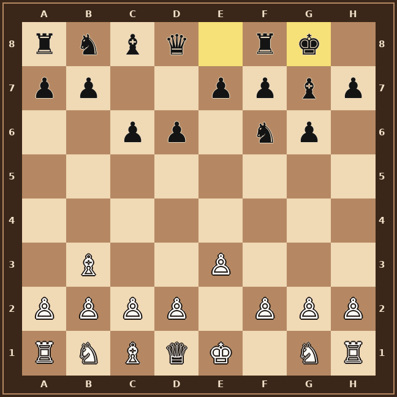

### Hello there! 👋

YouTube creator | Chess player | Gamer | Tech enthusiast

<!-- YT_STATS_START -->
  
<!-- YT_STATS_END -->

---

<!-- CHESS_START -->
### ♟️ Play chess with me!
*It's **me vs. the whole world**, team up with other visitors to outsmart me and claim a win for the guests!*

⬜ **Your turn! Play White (bottom).** Any guest can make the next move.

**Series score:** Krzys3n **1** : **0** Guests *(Draws: 0)*

#### 🎯 Choose a move (FROM → TO)

| FROM | TO - click a move |
| :---: | :--- |
| **A2** | [A3](https://github.com/Krzys3n/Krzys3n/issues/new?title=chess%3A%20a2a3&body=Chess%20move%3A%20%60a2a3%60%0A%0AClick%20%2A%2ACreate%20new%20issue%2A%2A%20to%20play%20this%20move.), [A4](https://github.com/Krzys3n/Krzys3n/issues/new?title=chess%3A%20a2a4&body=Chess%20move%3A%20%60a2a4%60%0A%0AClick%20%2A%2ACreate%20new%20issue%2A%2A%20to%20play%20this%20move.) |
| **B1** | [C3](https://github.com/Krzys3n/Krzys3n/issues/new?title=chess%3A%20b1c3&body=Chess%20move%3A%20%60b1c3%60%0A%0AClick%20%2A%2ACreate%20new%20issue%2A%2A%20to%20play%20this%20move.), [A3](https://github.com/Krzys3n/Krzys3n/issues/new?title=chess%3A%20b1a3&body=Chess%20move%3A%20%60b1a3%60%0A%0AClick%20%2A%2ACreate%20new%20issue%2A%2A%20to%20play%20this%20move.) |
| **B3** | [F7](https://github.com/Krzys3n/Krzys3n/issues/new?title=chess%3A%20b3f7&body=Chess%20move%3A%20%60b3f7%60%0A%0AClick%20%2A%2ACreate%20new%20issue%2A%2A%20to%20play%20this%20move.), [E6](https://github.com/Krzys3n/Krzys3n/issues/new?title=chess%3A%20b3e6&body=Chess%20move%3A%20%60b3e6%60%0A%0AClick%20%2A%2ACreate%20new%20issue%2A%2A%20to%20play%20this%20move.), [D5](https://github.com/Krzys3n/Krzys3n/issues/new?title=chess%3A%20b3d5&body=Chess%20move%3A%20%60b3d5%60%0A%0AClick%20%2A%2ACreate%20new%20issue%2A%2A%20to%20play%20this%20move.), [C4](https://github.com/Krzys3n/Krzys3n/issues/new?title=chess%3A%20b3c4&body=Chess%20move%3A%20%60b3c4%60%0A%0AClick%20%2A%2ACreate%20new%20issue%2A%2A%20to%20play%20this%20move.), [A4](https://github.com/Krzys3n/Krzys3n/issues/new?title=chess%3A%20b3a4&body=Chess%20move%3A%20%60b3a4%60%0A%0AClick%20%2A%2ACreate%20new%20issue%2A%2A%20to%20play%20this%20move.) |
| **C2** | [C3](https://github.com/Krzys3n/Krzys3n/issues/new?title=chess%3A%20c2c3&body=Chess%20move%3A%20%60c2c3%60%0A%0AClick%20%2A%2ACreate%20new%20issue%2A%2A%20to%20play%20this%20move.), [C4](https://github.com/Krzys3n/Krzys3n/issues/new?title=chess%3A%20c2c4&body=Chess%20move%3A%20%60c2c4%60%0A%0AClick%20%2A%2ACreate%20new%20issue%2A%2A%20to%20play%20this%20move.) |
| **D1** | [H5](https://github.com/Krzys3n/Krzys3n/issues/new?title=chess%3A%20d1h5&body=Chess%20move%3A%20%60d1h5%60%0A%0AClick%20%2A%2ACreate%20new%20issue%2A%2A%20to%20play%20this%20move.), [G4](https://github.com/Krzys3n/Krzys3n/issues/new?title=chess%3A%20d1g4&body=Chess%20move%3A%20%60d1g4%60%0A%0AClick%20%2A%2ACreate%20new%20issue%2A%2A%20to%20play%20this%20move.), [F3](https://github.com/Krzys3n/Krzys3n/issues/new?title=chess%3A%20d1f3&body=Chess%20move%3A%20%60d1f3%60%0A%0AClick%20%2A%2ACreate%20new%20issue%2A%2A%20to%20play%20this%20move.), [E2](https://github.com/Krzys3n/Krzys3n/issues/new?title=chess%3A%20d1e2&body=Chess%20move%3A%20%60d1e2%60%0A%0AClick%20%2A%2ACreate%20new%20issue%2A%2A%20to%20play%20this%20move.) |
| **D2** | [D3](https://github.com/Krzys3n/Krzys3n/issues/new?title=chess%3A%20d2d3&body=Chess%20move%3A%20%60d2d3%60%0A%0AClick%20%2A%2ACreate%20new%20issue%2A%2A%20to%20play%20this%20move.), [D4](https://github.com/Krzys3n/Krzys3n/issues/new?title=chess%3A%20d2d4&body=Chess%20move%3A%20%60d2d4%60%0A%0AClick%20%2A%2ACreate%20new%20issue%2A%2A%20to%20play%20this%20move.) |
| **E1** | [E2](https://github.com/Krzys3n/Krzys3n/issues/new?title=chess%3A%20e1e2&body=Chess%20move%3A%20%60e1e2%60%0A%0AClick%20%2A%2ACreate%20new%20issue%2A%2A%20to%20play%20this%20move.), [F1](https://github.com/Krzys3n/Krzys3n/issues/new?title=chess%3A%20e1f1&body=Chess%20move%3A%20%60e1f1%60%0A%0AClick%20%2A%2ACreate%20new%20issue%2A%2A%20to%20play%20this%20move.) |
| **E3** | [E4](https://github.com/Krzys3n/Krzys3n/issues/new?title=chess%3A%20e3e4&body=Chess%20move%3A%20%60e3e4%60%0A%0AClick%20%2A%2ACreate%20new%20issue%2A%2A%20to%20play%20this%20move.) |
| **F2** | [F3](https://github.com/Krzys3n/Krzys3n/issues/new?title=chess%3A%20f2f3&body=Chess%20move%3A%20%60f2f3%60%0A%0AClick%20%2A%2ACreate%20new%20issue%2A%2A%20to%20play%20this%20move.), [F4](https://github.com/Krzys3n/Krzys3n/issues/new?title=chess%3A%20f2f4&body=Chess%20move%3A%20%60f2f4%60%0A%0AClick%20%2A%2ACreate%20new%20issue%2A%2A%20to%20play%20this%20move.) |
| **G1** | [H3](https://github.com/Krzys3n/Krzys3n/issues/new?title=chess%3A%20g1h3&body=Chess%20move%3A%20%60g1h3%60%0A%0AClick%20%2A%2ACreate%20new%20issue%2A%2A%20to%20play%20this%20move.), [F3](https://github.com/Krzys3n/Krzys3n/issues/new?title=chess%3A%20g1f3&body=Chess%20move%3A%20%60g1f3%60%0A%0AClick%20%2A%2ACreate%20new%20issue%2A%2A%20to%20play%20this%20move.), [E2](https://github.com/Krzys3n/Krzys3n/issues/new?title=chess%3A%20g1e2&body=Chess%20move%3A%20%60g1e2%60%0A%0AClick%20%2A%2ACreate%20new%20issue%2A%2A%20to%20play%20this%20move.) |
| **G2** | [G3](https://github.com/Krzys3n/Krzys3n/issues/new?title=chess%3A%20g2g3&body=Chess%20move%3A%20%60g2g3%60%0A%0AClick%20%2A%2ACreate%20new%20issue%2A%2A%20to%20play%20this%20move.), [G4](https://github.com/Krzys3n/Krzys3n/issues/new?title=chess%3A%20g2g4&body=Chess%20move%3A%20%60g2g4%60%0A%0AClick%20%2A%2ACreate%20new%20issue%2A%2A%20to%20play%20this%20move.) |
| **H2** | [H3](https://github.com/Krzys3n/Krzys3n/issues/new?title=chess%3A%20h2h3&body=Chess%20move%3A%20%60h2h3%60%0A%0AClick%20%2A%2ACreate%20new%20issue%2A%2A%20to%20play%20this%20move.), [H4](https://github.com/Krzys3n/Krzys3n/issues/new?title=chess%3A%20h2h4&body=Chess%20move%3A%20%60h2h4%60%0A%0AClick%20%2A%2ACreate%20new%20issue%2A%2A%20to%20play%20this%20move.) |

**Surrender votes (0)** [🏳️ Vote to surrender](https://github.com/Krzys3n/Krzys3n/issues/new?title=chess%3A%20surrender&body=Vote%20to%20surrender%20the%20current%20game.%0A%0AClick%20%2A%2ACreate%20new%20issue%2A%2A%20to%20submit%20your%20vote.)  
*If you feel that the position is lost, you can vote to surrender. If I see two votes in a row, I will reset the board and mark it as a win.*

#### How to play
Click a move link in **FROM → TO** to open a pre-filled Issue, then click **Create new issue**. GitHub Actions validates the move, updates the board, and closes the Issue. *(Inspired by [timburgan](https://github.com/timburgan)).*

#### 🤝 Fair play & community
Feel free to share my profile with friends who know the rules of chess and team up with them to find the best move! As a gentleman's agreement, **no chess engines** I play my moves on my own, and you play yours with pure human brainpower.

#### Last few moves

| Move | Who |
| :--- | :--- |
| E8 to G8 | [@Krzys3n](https://github.com/Krzys3n) |
| F3 to D1 | [@Nlxtz](https://github.com/Nlxtz) |
| G8 to F6 | [@Krzys3n](https://github.com/Krzys3n) |
| D1 to F3 | [@Mniok](https://github.com/Mniok) |
| F8 to G7 | [@Krzys3n](https://github.com/Krzys3n) |

#### Guest Leaderboard

| Moves | Guest |
| :---: | :--- |
| 21 | [@Mniok](https://github.com/Mniok) |
| 1 | [@Nlxtz](https://github.com/Nlxtz) |
| 1 | [@Shiro99x](https://github.com/Shiro99x) |
| 1 | [@uriel346as](https://github.com/uriel346as) |
| 1 | [@Zafkieli](https://github.com/Zafkieli) |

📜 *Past games history (PGN & stats) will be saved [here](https://github.com/Krzys3n/Krzys3n/tree/main/chess_games/history).*
<!-- CHESS_END -->
