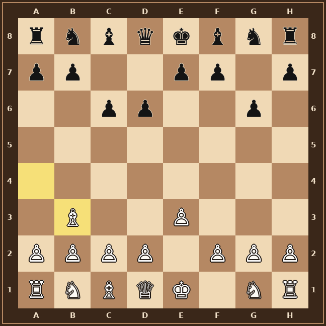

### Hello there! 👋

YouTube creator | Chess player | Gamer | Tech enthusiast

<!-- YT_STATS_START -->
  
<!-- YT_STATS_END -->

---

<!-- CHESS_START -->
### ♟️ Play chess with me!
*It's **me vs. the whole world**, team up with other visitors to outsmart me and claim a win for the guests!*

⬛ **@Krzys3n's turn (Black — top).** Restricted to the profile owner.

**Series score:** Krzys3n **1** : **0** Guests *(Draws: 0)*

#### 🎯 Choose a move (FROM → TO)

| FROM | TO - click a move |
| :---: | :--- |
| **A7** | [A6](https://github.com/Krzys3n/Krzys3n/issues/new?title=chess%3A%20a7a6&body=Chess%20move%3A%20%60a7a6%60%0A%0AClick%20%2A%2ACreate%20new%20issue%2A%2A%20to%20play%20this%20move.), [A5](https://github.com/Krzys3n/Krzys3n/issues/new?title=chess%3A%20a7a5&body=Chess%20move%3A%20%60a7a5%60%0A%0AClick%20%2A%2ACreate%20new%20issue%2A%2A%20to%20play%20this%20move.) |
| **B7** | [B6](https://github.com/Krzys3n/Krzys3n/issues/new?title=chess%3A%20b7b6&body=Chess%20move%3A%20%60b7b6%60%0A%0AClick%20%2A%2ACreate%20new%20issue%2A%2A%20to%20play%20this%20move.), [B5](https://github.com/Krzys3n/Krzys3n/issues/new?title=chess%3A%20b7b5&body=Chess%20move%3A%20%60b7b5%60%0A%0AClick%20%2A%2ACreate%20new%20issue%2A%2A%20to%20play%20this%20move.) |
| **B8** | [D7](https://github.com/Krzys3n/Krzys3n/issues/new?title=chess%3A%20b8d7&body=Chess%20move%3A%20%60b8d7%60%0A%0AClick%20%2A%2ACreate%20new%20issue%2A%2A%20to%20play%20this%20move.), [A6](https://github.com/Krzys3n/Krzys3n/issues/new?title=chess%3A%20b8a6&body=Chess%20move%3A%20%60b8a6%60%0A%0AClick%20%2A%2ACreate%20new%20issue%2A%2A%20to%20play%20this%20move.) |
| **C6** | [C5](https://github.com/Krzys3n/Krzys3n/issues/new?title=chess%3A%20c6c5&body=Chess%20move%3A%20%60c6c5%60%0A%0AClick%20%2A%2ACreate%20new%20issue%2A%2A%20to%20play%20this%20move.) |
| **C8** | [D7](https://github.com/Krzys3n/Krzys3n/issues/new?title=chess%3A%20c8d7&body=Chess%20move%3A%20%60c8d7%60%0A%0AClick%20%2A%2ACreate%20new%20issue%2A%2A%20to%20play%20this%20move.), [E6](https://github.com/Krzys3n/Krzys3n/issues/new?title=chess%3A%20c8e6&body=Chess%20move%3A%20%60c8e6%60%0A%0AClick%20%2A%2ACreate%20new%20issue%2A%2A%20to%20play%20this%20move.), [F5](https://github.com/Krzys3n/Krzys3n/issues/new?title=chess%3A%20c8f5&body=Chess%20move%3A%20%60c8f5%60%0A%0AClick%20%2A%2ACreate%20new%20issue%2A%2A%20to%20play%20this%20move.), [G4](https://github.com/Krzys3n/Krzys3n/issues/new?title=chess%3A%20c8g4&body=Chess%20move%3A%20%60c8g4%60%0A%0AClick%20%2A%2ACreate%20new%20issue%2A%2A%20to%20play%20this%20move.), [H3](https://github.com/Krzys3n/Krzys3n/issues/new?title=chess%3A%20c8h3&body=Chess%20move%3A%20%60c8h3%60%0A%0AClick%20%2A%2ACreate%20new%20issue%2A%2A%20to%20play%20this%20move.) |
| **D6** | [D5](https://github.com/Krzys3n/Krzys3n/issues/new?title=chess%3A%20d6d5&body=Chess%20move%3A%20%60d6d5%60%0A%0AClick%20%2A%2ACreate%20new%20issue%2A%2A%20to%20play%20this%20move.) |
| **D8** | [D7](https://github.com/Krzys3n/Krzys3n/issues/new?title=chess%3A%20d8d7&body=Chess%20move%3A%20%60d8d7%60%0A%0AClick%20%2A%2ACreate%20new%20issue%2A%2A%20to%20play%20this%20move.), [C7](https://github.com/Krzys3n/Krzys3n/issues/new?title=chess%3A%20d8c7&body=Chess%20move%3A%20%60d8c7%60%0A%0AClick%20%2A%2ACreate%20new%20issue%2A%2A%20to%20play%20this%20move.), [B6](https://github.com/Krzys3n/Krzys3n/issues/new?title=chess%3A%20d8b6&body=Chess%20move%3A%20%60d8b6%60%0A%0AClick%20%2A%2ACreate%20new%20issue%2A%2A%20to%20play%20this%20move.), [A5](https://github.com/Krzys3n/Krzys3n/issues/new?title=chess%3A%20d8a5&body=Chess%20move%3A%20%60d8a5%60%0A%0AClick%20%2A%2ACreate%20new%20issue%2A%2A%20to%20play%20this%20move.) |
| **E7** | [E6](https://github.com/Krzys3n/Krzys3n/issues/new?title=chess%3A%20e7e6&body=Chess%20move%3A%20%60e7e6%60%0A%0AClick%20%2A%2ACreate%20new%20issue%2A%2A%20to%20play%20this%20move.), [E5](https://github.com/Krzys3n/Krzys3n/issues/new?title=chess%3A%20e7e5&body=Chess%20move%3A%20%60e7e5%60%0A%0AClick%20%2A%2ACreate%20new%20issue%2A%2A%20to%20play%20this%20move.) |
| **E8** | [D7](https://github.com/Krzys3n/Krzys3n/issues/new?title=chess%3A%20e8d7&body=Chess%20move%3A%20%60e8d7%60%0A%0AClick%20%2A%2ACreate%20new%20issue%2A%2A%20to%20play%20this%20move.) |
| **F7** | [F6](https://github.com/Krzys3n/Krzys3n/issues/new?title=chess%3A%20f7f6&body=Chess%20move%3A%20%60f7f6%60%0A%0AClick%20%2A%2ACreate%20new%20issue%2A%2A%20to%20play%20this%20move.), [F5](https://github.com/Krzys3n/Krzys3n/issues/new?title=chess%3A%20f7f5&body=Chess%20move%3A%20%60f7f5%60%0A%0AClick%20%2A%2ACreate%20new%20issue%2A%2A%20to%20play%20this%20move.) |
| **F8** | [G7](https://github.com/Krzys3n/Krzys3n/issues/new?title=chess%3A%20f8g7&body=Chess%20move%3A%20%60f8g7%60%0A%0AClick%20%2A%2ACreate%20new%20issue%2A%2A%20to%20play%20this%20move.), [H6](https://github.com/Krzys3n/Krzys3n/issues/new?title=chess%3A%20f8h6&body=Chess%20move%3A%20%60f8h6%60%0A%0AClick%20%2A%2ACreate%20new%20issue%2A%2A%20to%20play%20this%20move.) |
| **G6** | [G5](https://github.com/Krzys3n/Krzys3n/issues/new?title=chess%3A%20g6g5&body=Chess%20move%3A%20%60g6g5%60%0A%0AClick%20%2A%2ACreate%20new%20issue%2A%2A%20to%20play%20this%20move.) |
| **G8** | [H6](https://github.com/Krzys3n/Krzys3n/issues/new?title=chess%3A%20g8h6&body=Chess%20move%3A%20%60g8h6%60%0A%0AClick%20%2A%2ACreate%20new%20issue%2A%2A%20to%20play%20this%20move.), [F6](https://github.com/Krzys3n/Krzys3n/issues/new?title=chess%3A%20g8f6&body=Chess%20move%3A%20%60g8f6%60%0A%0AClick%20%2A%2ACreate%20new%20issue%2A%2A%20to%20play%20this%20move.) |
| **H7** | [H6](https://github.com/Krzys3n/Krzys3n/issues/new?title=chess%3A%20h7h6&body=Chess%20move%3A%20%60h7h6%60%0A%0AClick%20%2A%2ACreate%20new%20issue%2A%2A%20to%20play%20this%20move.), [H5](https://github.com/Krzys3n/Krzys3n/issues/new?title=chess%3A%20h7h5&body=Chess%20move%3A%20%60h7h5%60%0A%0AClick%20%2A%2ACreate%20new%20issue%2A%2A%20to%20play%20this%20move.) |

**Surrender votes (0)** [🏳️ Vote to surrender](https://github.com/Krzys3n/Krzys3n/issues/new?title=chess%3A%20surrender&body=Vote%20to%20surrender%20the%20current%20game.%0A%0AClick%20%2A%2ACreate%20new%20issue%2A%2A%20to%20submit%20your%20vote.)  
*If you feel that the position is lost, you can vote to surrender. If I see two votes in a row, I will reset the board and mark it as a win.*

#### How to play
Click a move link in **FROM → TO** to open a pre-filled Issue, then click **Create new issue**. GitHub Actions validates the move, updates the board, and closes the Issue. *(Inspired by [timburgan](https://github.com/timburgan)).*

#### 🤝 Fair play & community
Feel free to share my profile with friends who know the rules of chess and team up with them to find the best move! As a gentleman's agreement, **no chess engines** I play my moves on my own, and you play yours with pure human brainpower.

#### Last few moves

| Move | Who |
| :--- | :--- |
| A4 to B3 | [@Mniok](https://github.com/Mniok) |
| G7 to G6 | [@Krzys3n](https://github.com/Krzys3n) |
| B5 to A4 | [@Mniok](https://github.com/Mniok) |
| C7 to C6 | [@Krzys3n](https://github.com/Krzys3n) |
| F1 to B5 | [@Mniok](https://github.com/Mniok) |

#### Guest Leaderboard

| Moves | Guest |
| :---: | :--- |
| 20 | [@Mniok](https://github.com/Mniok) |
| 1 | [@Shiro99x](https://github.com/Shiro99x) |
| 1 | [@uriel346as](https://github.com/uriel346as) |
| 1 | [@Zafkieli](https://github.com/Zafkieli) |

📜 *Past games history (PGN & stats) will be saved [here](https://github.com/Krzys3n/Krzys3n/tree/main/chess_games/history).*
<!-- CHESS_END -->
