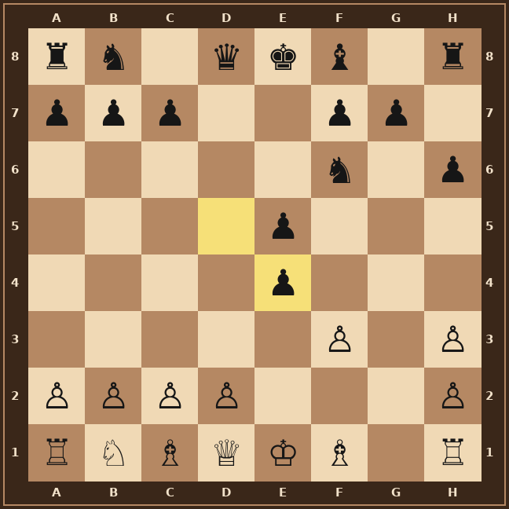

### Hello there! 👋

YouTube creator | Chess player | Gamer | Tech enthusiast

<!-- YT_STATS_START -->
  
<!-- YT_STATS_END -->

---

<!-- CHESS_START -->
### ♟️ Play chess with me!

⬜ **Your turn! Play White (bottom).** Any guest can make the next move.

**Series score:** Krzys3n **0** : **0** Guests *(Draws: 0)*

#### 🎯 Choose a move (FROM → TO)

| FROM | TO - click a move |
| :---: | :--- |
| **A2** | [A3](https://github.com/Krzys3n/Krzys3n/issues/new?title=chess%3A%20a2a3&body=Chess%20move%3A%20%60a2a3%60%0A%0AClick%20%2A%2ACreate%20new%20issue%2A%2A%20to%20play%20this%20move.), [A4](https://github.com/Krzys3n/Krzys3n/issues/new?title=chess%3A%20a2a4&body=Chess%20move%3A%20%60a2a4%60%0A%0AClick%20%2A%2ACreate%20new%20issue%2A%2A%20to%20play%20this%20move.) |
| **B1** | [C3](https://github.com/Krzys3n/Krzys3n/issues/new?title=chess%3A%20b1c3&body=Chess%20move%3A%20%60b1c3%60%0A%0AClick%20%2A%2ACreate%20new%20issue%2A%2A%20to%20play%20this%20move.), [A3](https://github.com/Krzys3n/Krzys3n/issues/new?title=chess%3A%20b1a3&body=Chess%20move%3A%20%60b1a3%60%0A%0AClick%20%2A%2ACreate%20new%20issue%2A%2A%20to%20play%20this%20move.) |
| **B2** | [B3](https://github.com/Krzys3n/Krzys3n/issues/new?title=chess%3A%20b2b3&body=Chess%20move%3A%20%60b2b3%60%0A%0AClick%20%2A%2ACreate%20new%20issue%2A%2A%20to%20play%20this%20move.), [B4](https://github.com/Krzys3n/Krzys3n/issues/new?title=chess%3A%20b2b4&body=Chess%20move%3A%20%60b2b4%60%0A%0AClick%20%2A%2ACreate%20new%20issue%2A%2A%20to%20play%20this%20move.) |
| **C2** | [C3](https://github.com/Krzys3n/Krzys3n/issues/new?title=chess%3A%20c2c3&body=Chess%20move%3A%20%60c2c3%60%0A%0AClick%20%2A%2ACreate%20new%20issue%2A%2A%20to%20play%20this%20move.), [C4](https://github.com/Krzys3n/Krzys3n/issues/new?title=chess%3A%20c2c4&body=Chess%20move%3A%20%60c2c4%60%0A%0AClick%20%2A%2ACreate%20new%20issue%2A%2A%20to%20play%20this%20move.) |
| **D1** | [E2](https://github.com/Krzys3n/Krzys3n/issues/new?title=chess%3A%20d1e2&body=Chess%20move%3A%20%60d1e2%60%0A%0AClick%20%2A%2ACreate%20new%20issue%2A%2A%20to%20play%20this%20move.) |
| **D2** | [D3](https://github.com/Krzys3n/Krzys3n/issues/new?title=chess%3A%20d2d3&body=Chess%20move%3A%20%60d2d3%60%0A%0AClick%20%2A%2ACreate%20new%20issue%2A%2A%20to%20play%20this%20move.), [D4](https://github.com/Krzys3n/Krzys3n/issues/new?title=chess%3A%20d2d4&body=Chess%20move%3A%20%60d2d4%60%0A%0AClick%20%2A%2ACreate%20new%20issue%2A%2A%20to%20play%20this%20move.) |
| **E1** | [F2](https://github.com/Krzys3n/Krzys3n/issues/new?title=chess%3A%20e1f2&body=Chess%20move%3A%20%60e1f2%60%0A%0AClick%20%2A%2ACreate%20new%20issue%2A%2A%20to%20play%20this%20move.), [E2](https://github.com/Krzys3n/Krzys3n/issues/new?title=chess%3A%20e1e2&body=Chess%20move%3A%20%60e1e2%60%0A%0AClick%20%2A%2ACreate%20new%20issue%2A%2A%20to%20play%20this%20move.) |
| **F1** | [A6](https://github.com/Krzys3n/Krzys3n/issues/new?title=chess%3A%20f1a6&body=Chess%20move%3A%20%60f1a6%60%0A%0AClick%20%2A%2ACreate%20new%20issue%2A%2A%20to%20play%20this%20move.), [B5](https://github.com/Krzys3n/Krzys3n/issues/new?title=chess%3A%20f1b5&body=Chess%20move%3A%20%60f1b5%60%0A%0AClick%20%2A%2ACreate%20new%20issue%2A%2A%20to%20play%20this%20move.), [C4](https://github.com/Krzys3n/Krzys3n/issues/new?title=chess%3A%20f1c4&body=Chess%20move%3A%20%60f1c4%60%0A%0AClick%20%2A%2ACreate%20new%20issue%2A%2A%20to%20play%20this%20move.), [D3](https://github.com/Krzys3n/Krzys3n/issues/new?title=chess%3A%20f1d3&body=Chess%20move%3A%20%60f1d3%60%0A%0AClick%20%2A%2ACreate%20new%20issue%2A%2A%20to%20play%20this%20move.), [G2](https://github.com/Krzys3n/Krzys3n/issues/new?title=chess%3A%20f1g2&body=Chess%20move%3A%20%60f1g2%60%0A%0AClick%20%2A%2ACreate%20new%20issue%2A%2A%20to%20play%20this%20move.), [E2](https://github.com/Krzys3n/Krzys3n/issues/new?title=chess%3A%20f1e2&body=Chess%20move%3A%20%60f1e2%60%0A%0AClick%20%2A%2ACreate%20new%20issue%2A%2A%20to%20play%20this%20move.) |
| **F3** | [E4](https://github.com/Krzys3n/Krzys3n/issues/new?title=chess%3A%20f3e4&body=Chess%20move%3A%20%60f3e4%60%0A%0AClick%20%2A%2ACreate%20new%20issue%2A%2A%20to%20play%20this%20move.), [F4](https://github.com/Krzys3n/Krzys3n/issues/new?title=chess%3A%20f3f4&body=Chess%20move%3A%20%60f3f4%60%0A%0AClick%20%2A%2ACreate%20new%20issue%2A%2A%20to%20play%20this%20move.) |
| **H1** | [G1](https://github.com/Krzys3n/Krzys3n/issues/new?title=chess%3A%20h1g1&body=Chess%20move%3A%20%60h1g1%60%0A%0AClick%20%2A%2ACreate%20new%20issue%2A%2A%20to%20play%20this%20move.) |
| **H3** | [H4](https://github.com/Krzys3n/Krzys3n/issues/new?title=chess%3A%20h3h4&body=Chess%20move%3A%20%60h3h4%60%0A%0AClick%20%2A%2ACreate%20new%20issue%2A%2A%20to%20play%20this%20move.) |

#### How to play
Click a move link in **FROM → TO** to open a pre-filled Issue, then click **Create new issue**. GitHub Actions validates the move, updates the board, and closes the Issue. *(Inspired by [timburgan](https://github.com/timburgan)).*

#### Last few moves

| Move | Who |
| :--- | :--- |
| D5 to E4 | [@Krzys3n](https://github.com/Krzys3n) |
| G2 to H3 | [@Mniok](https://github.com/Mniok) |
| C8 to H3 | [@Krzys3n](https://github.com/Krzys3n) |
| G5 to H3 | [@Mniok](https://github.com/Mniok) |
| H7 to H6 | [@Krzys3n](https://github.com/Krzys3n) |

#### Guest Leaderboard

| Moves | Guest |
| :---: | :--- |
| 6 | [@Mniok](https://github.com/Mniok) |
<!-- CHESS_END -->
