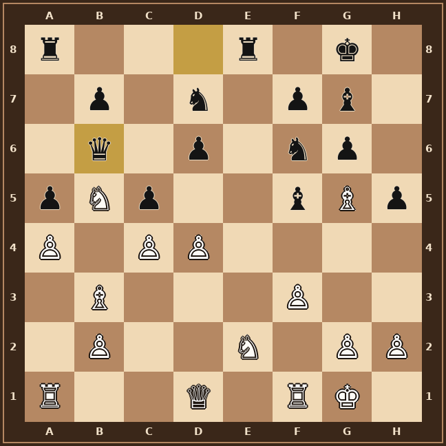

### Hello there! 👋

YouTube creator | Chess player | Gamer | Tech enthusiast

<!-- YT_STATS_START -->
  
<!-- YT_STATS_END -->

---

<!-- CHESS_START -->
### ♟️ Play chess with me!
*It's **me vs. the whole world**, team up with other visitors to outsmart me and claim a win for the guests!*

⬜ **Your turn! Play White (bottom).** Any guest can make the next move.

**Series score:** Krzys3n **1** : **0** Guests *(Draws: 0)*

#### 🎯 Choose a move (FROM → TO)

| FROM | TO - click a move |
| :---: | :--- |
| **A1** | [A3](https://github.com/Krzys3n/Krzys3n/issues/new?title=chess%3A%20a1a3&body=Chess%20move%3A%20%60a1a3%60%0A%0AClick%20%2A%2ACreate%20new%20issue%2A%2A%20to%20play%20this%20move.), [A2](https://github.com/Krzys3n/Krzys3n/issues/new?title=chess%3A%20a1a2&body=Chess%20move%3A%20%60a1a2%60%0A%0AClick%20%2A%2ACreate%20new%20issue%2A%2A%20to%20play%20this%20move.), [C1](https://github.com/Krzys3n/Krzys3n/issues/new?title=chess%3A%20a1c1&body=Chess%20move%3A%20%60a1c1%60%0A%0AClick%20%2A%2ACreate%20new%20issue%2A%2A%20to%20play%20this%20move.), [B1](https://github.com/Krzys3n/Krzys3n/issues/new?title=chess%3A%20a1b1&body=Chess%20move%3A%20%60a1b1%60%0A%0AClick%20%2A%2ACreate%20new%20issue%2A%2A%20to%20play%20this%20move.) |
| **B3** | [C2](https://github.com/Krzys3n/Krzys3n/issues/new?title=chess%3A%20b3c2&body=Chess%20move%3A%20%60b3c2%60%0A%0AClick%20%2A%2ACreate%20new%20issue%2A%2A%20to%20play%20this%20move.), [A2](https://github.com/Krzys3n/Krzys3n/issues/new?title=chess%3A%20b3a2&body=Chess%20move%3A%20%60b3a2%60%0A%0AClick%20%2A%2ACreate%20new%20issue%2A%2A%20to%20play%20this%20move.) |
| **B5** | [C7](https://github.com/Krzys3n/Krzys3n/issues/new?title=chess%3A%20b5c7&body=Chess%20move%3A%20%60b5c7%60%0A%0AClick%20%2A%2ACreate%20new%20issue%2A%2A%20to%20play%20this%20move.), [A7](https://github.com/Krzys3n/Krzys3n/issues/new?title=chess%3A%20b5a7&body=Chess%20move%3A%20%60b5a7%60%0A%0AClick%20%2A%2ACreate%20new%20issue%2A%2A%20to%20play%20this%20move.), [D6](https://github.com/Krzys3n/Krzys3n/issues/new?title=chess%3A%20b5d6&body=Chess%20move%3A%20%60b5d6%60%0A%0AClick%20%2A%2ACreate%20new%20issue%2A%2A%20to%20play%20this%20move.), [C3](https://github.com/Krzys3n/Krzys3n/issues/new?title=chess%3A%20b5c3&body=Chess%20move%3A%20%60b5c3%60%0A%0AClick%20%2A%2ACreate%20new%20issue%2A%2A%20to%20play%20this%20move.), [A3](https://github.com/Krzys3n/Krzys3n/issues/new?title=chess%3A%20b5a3&body=Chess%20move%3A%20%60b5a3%60%0A%0AClick%20%2A%2ACreate%20new%20issue%2A%2A%20to%20play%20this%20move.) |
| **D1** | [D3](https://github.com/Krzys3n/Krzys3n/issues/new?title=chess%3A%20d1d3&body=Chess%20move%3A%20%60d1d3%60%0A%0AClick%20%2A%2ACreate%20new%20issue%2A%2A%20to%20play%20this%20move.), [D2](https://github.com/Krzys3n/Krzys3n/issues/new?title=chess%3A%20d1d2&body=Chess%20move%3A%20%60d1d2%60%0A%0AClick%20%2A%2ACreate%20new%20issue%2A%2A%20to%20play%20this%20move.), [C2](https://github.com/Krzys3n/Krzys3n/issues/new?title=chess%3A%20d1c2&body=Chess%20move%3A%20%60d1c2%60%0A%0AClick%20%2A%2ACreate%20new%20issue%2A%2A%20to%20play%20this%20move.), [E1](https://github.com/Krzys3n/Krzys3n/issues/new?title=chess%3A%20d1e1&body=Chess%20move%3A%20%60d1e1%60%0A%0AClick%20%2A%2ACreate%20new%20issue%2A%2A%20to%20play%20this%20move.), [C1](https://github.com/Krzys3n/Krzys3n/issues/new?title=chess%3A%20d1c1&body=Chess%20move%3A%20%60d1c1%60%0A%0AClick%20%2A%2ACreate%20new%20issue%2A%2A%20to%20play%20this%20move.), [B1](https://github.com/Krzys3n/Krzys3n/issues/new?title=chess%3A%20d1b1&body=Chess%20move%3A%20%60d1b1%60%0A%0AClick%20%2A%2ACreate%20new%20issue%2A%2A%20to%20play%20this%20move.) |
| **D4** | [C5](https://github.com/Krzys3n/Krzys3n/issues/new?title=chess%3A%20d4c5&body=Chess%20move%3A%20%60d4c5%60%0A%0AClick%20%2A%2ACreate%20new%20issue%2A%2A%20to%20play%20this%20move.), [D5](https://github.com/Krzys3n/Krzys3n/issues/new?title=chess%3A%20d4d5&body=Chess%20move%3A%20%60d4d5%60%0A%0AClick%20%2A%2ACreate%20new%20issue%2A%2A%20to%20play%20this%20move.) |
| **E2** | [F4](https://github.com/Krzys3n/Krzys3n/issues/new?title=chess%3A%20e2f4&body=Chess%20move%3A%20%60e2f4%60%0A%0AClick%20%2A%2ACreate%20new%20issue%2A%2A%20to%20play%20this%20move.), [G3](https://github.com/Krzys3n/Krzys3n/issues/new?title=chess%3A%20e2g3&body=Chess%20move%3A%20%60e2g3%60%0A%0AClick%20%2A%2ACreate%20new%20issue%2A%2A%20to%20play%20this%20move.), [C3](https://github.com/Krzys3n/Krzys3n/issues/new?title=chess%3A%20e2c3&body=Chess%20move%3A%20%60e2c3%60%0A%0AClick%20%2A%2ACreate%20new%20issue%2A%2A%20to%20play%20this%20move.), [C1](https://github.com/Krzys3n/Krzys3n/issues/new?title=chess%3A%20e2c1&body=Chess%20move%3A%20%60e2c1%60%0A%0AClick%20%2A%2ACreate%20new%20issue%2A%2A%20to%20play%20this%20move.) |
| **F1** | [F2](https://github.com/Krzys3n/Krzys3n/issues/new?title=chess%3A%20f1f2&body=Chess%20move%3A%20%60f1f2%60%0A%0AClick%20%2A%2ACreate%20new%20issue%2A%2A%20to%20play%20this%20move.), [E1](https://github.com/Krzys3n/Krzys3n/issues/new?title=chess%3A%20f1e1&body=Chess%20move%3A%20%60f1e1%60%0A%0AClick%20%2A%2ACreate%20new%20issue%2A%2A%20to%20play%20this%20move.) |
| **F3** | [F4](https://github.com/Krzys3n/Krzys3n/issues/new?title=chess%3A%20f3f4&body=Chess%20move%3A%20%60f3f4%60%0A%0AClick%20%2A%2ACreate%20new%20issue%2A%2A%20to%20play%20this%20move.) |
| **G1** | [F2](https://github.com/Krzys3n/Krzys3n/issues/new?title=chess%3A%20g1f2&body=Chess%20move%3A%20%60g1f2%60%0A%0AClick%20%2A%2ACreate%20new%20issue%2A%2A%20to%20play%20this%20move.), [H1](https://github.com/Krzys3n/Krzys3n/issues/new?title=chess%3A%20g1h1&body=Chess%20move%3A%20%60g1h1%60%0A%0AClick%20%2A%2ACreate%20new%20issue%2A%2A%20to%20play%20this%20move.) |
| **G2** | [G3](https://github.com/Krzys3n/Krzys3n/issues/new?title=chess%3A%20g2g3&body=Chess%20move%3A%20%60g2g3%60%0A%0AClick%20%2A%2ACreate%20new%20issue%2A%2A%20to%20play%20this%20move.), [G4](https://github.com/Krzys3n/Krzys3n/issues/new?title=chess%3A%20g2g4&body=Chess%20move%3A%20%60g2g4%60%0A%0AClick%20%2A%2ACreate%20new%20issue%2A%2A%20to%20play%20this%20move.) |
| **G5** | [H6](https://github.com/Krzys3n/Krzys3n/issues/new?title=chess%3A%20g5h6&body=Chess%20move%3A%20%60g5h6%60%0A%0AClick%20%2A%2ACreate%20new%20issue%2A%2A%20to%20play%20this%20move.), [F6](https://github.com/Krzys3n/Krzys3n/issues/new?title=chess%3A%20g5f6&body=Chess%20move%3A%20%60g5f6%60%0A%0AClick%20%2A%2ACreate%20new%20issue%2A%2A%20to%20play%20this%20move.), [H4](https://github.com/Krzys3n/Krzys3n/issues/new?title=chess%3A%20g5h4&body=Chess%20move%3A%20%60g5h4%60%0A%0AClick%20%2A%2ACreate%20new%20issue%2A%2A%20to%20play%20this%20move.), [F4](https://github.com/Krzys3n/Krzys3n/issues/new?title=chess%3A%20g5f4&body=Chess%20move%3A%20%60g5f4%60%0A%0AClick%20%2A%2ACreate%20new%20issue%2A%2A%20to%20play%20this%20move.), [E3](https://github.com/Krzys3n/Krzys3n/issues/new?title=chess%3A%20g5e3&body=Chess%20move%3A%20%60g5e3%60%0A%0AClick%20%2A%2ACreate%20new%20issue%2A%2A%20to%20play%20this%20move.), [D2](https://github.com/Krzys3n/Krzys3n/issues/new?title=chess%3A%20g5d2&body=Chess%20move%3A%20%60g5d2%60%0A%0AClick%20%2A%2ACreate%20new%20issue%2A%2A%20to%20play%20this%20move.), [C1](https://github.com/Krzys3n/Krzys3n/issues/new?title=chess%3A%20g5c1&body=Chess%20move%3A%20%60g5c1%60%0A%0AClick%20%2A%2ACreate%20new%20issue%2A%2A%20to%20play%20this%20move.) |
| **H2** | [H3](https://github.com/Krzys3n/Krzys3n/issues/new?title=chess%3A%20h2h3&body=Chess%20move%3A%20%60h2h3%60%0A%0AClick%20%2A%2ACreate%20new%20issue%2A%2A%20to%20play%20this%20move.), [H4](https://github.com/Krzys3n/Krzys3n/issues/new?title=chess%3A%20h2h4&body=Chess%20move%3A%20%60h2h4%60%0A%0AClick%20%2A%2ACreate%20new%20issue%2A%2A%20to%20play%20this%20move.) |

**Surrender votes (0)** [🏳️ Vote to surrender](https://github.com/Krzys3n/Krzys3n/issues/new?title=chess%3A%20surrender&body=Vote%20to%20surrender%20the%20current%20game.%0A%0AClick%20%2A%2ACreate%20new%20issue%2A%2A%20to%20submit%20your%20vote.)  
*If you feel that the position is lost, you can vote to surrender. If I see two votes in a row, I will reset the board and mark it as a win.*

#### How to play
Click a move link in **FROM → TO** to open a pre-filled Issue, then click **Create new issue**. GitHub Actions validates the move, updates the board, and closes the Issue. *(Inspired by [timburgan](https://github.com/timburgan)).*

#### 🤝 Fair play & community
Feel free to share my profile with friends who know the rules of chess and team up with them to find the best move! As a gentleman's agreement, **no chess engines** I play my moves on my own, and you play yours with pure human brainpower.

#### Last few moves

| Move | Who |
| :--- | :--- |
| D8 to B6 | [@Krzys3n](https://github.com/Krzys3n) |
| C3 to B5 | [@Nlxtz](https://github.com/Nlxtz) |
| C6 to C5 | [@Krzys3n](https://github.com/Krzys3n) |
| C1 to G5 | [@quetzelcoatlus](https://github.com/quetzelcoatlus) |
| H7 to H5 | [@Krzys3n](https://github.com/Krzys3n) |

#### Guest Leaderboard

| Moves | Guest |
| :---: | :--- |
| 23 | [@Mniok](https://github.com/Mniok) |
| 7 | [@Nlxtz](https://github.com/Nlxtz) |
| 1 | [@jbuczkowski-naoko](https://github.com/jbuczkowski-naoko) |
| 1 | [@quetzelcoatlus](https://github.com/quetzelcoatlus) |
| 1 | [@Shiro99x](https://github.com/Shiro99x) |
| 1 | [@uriel346as](https://github.com/uriel346as) |
| 1 | [@Zafkieli](https://github.com/Zafkieli) |

📜 *Past games history (PGN & stats) will be saved [here](https://github.com/Krzys3n/Krzys3n/tree/main/chess_games/history).*
<!-- CHESS_END -->
