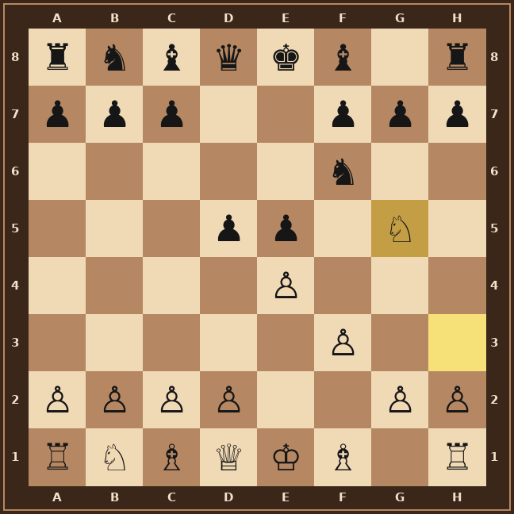

### Hello there! 👋

YouTube creator | Chess player | Gamer | Tech enthusiast

<!-- YT_STATS_START -->
  
<!-- YT_STATS_END -->

---

<!-- CHESS_START -->
### ♟️ Play chess with me!

⬛ **@Krzys3n's turn (Black — top).** Restricted to the profile owner.

**Series score:** Krzys3n **0** : **0** Guests *(Draws: 0)*

#### 🎯 Choose a move (FROM → TO)

| FROM | TO - click a move |
| :---: | :--- |
| **A7** | [A6](https://github.com/Krzys3n/Krzys3n/issues/new?title=chess%3A%20a7a6&body=Chess%20move%3A%20%60a7a6%60%0A%0AClick%20%2A%2ACreate%20new%20issue%2A%2A%20to%20play%20this%20move.), [A5](https://github.com/Krzys3n/Krzys3n/issues/new?title=chess%3A%20a7a5&body=Chess%20move%3A%20%60a7a5%60%0A%0AClick%20%2A%2ACreate%20new%20issue%2A%2A%20to%20play%20this%20move.) |
| **B7** | [B6](https://github.com/Krzys3n/Krzys3n/issues/new?title=chess%3A%20b7b6&body=Chess%20move%3A%20%60b7b6%60%0A%0AClick%20%2A%2ACreate%20new%20issue%2A%2A%20to%20play%20this%20move.), [B5](https://github.com/Krzys3n/Krzys3n/issues/new?title=chess%3A%20b7b5&body=Chess%20move%3A%20%60b7b5%60%0A%0AClick%20%2A%2ACreate%20new%20issue%2A%2A%20to%20play%20this%20move.) |
| **B8** | [D7](https://github.com/Krzys3n/Krzys3n/issues/new?title=chess%3A%20b8d7&body=Chess%20move%3A%20%60b8d7%60%0A%0AClick%20%2A%2ACreate%20new%20issue%2A%2A%20to%20play%20this%20move.), [C6](https://github.com/Krzys3n/Krzys3n/issues/new?title=chess%3A%20b8c6&body=Chess%20move%3A%20%60b8c6%60%0A%0AClick%20%2A%2ACreate%20new%20issue%2A%2A%20to%20play%20this%20move.), [A6](https://github.com/Krzys3n/Krzys3n/issues/new?title=chess%3A%20b8a6&body=Chess%20move%3A%20%60b8a6%60%0A%0AClick%20%2A%2ACreate%20new%20issue%2A%2A%20to%20play%20this%20move.) |
| **C7** | [C6](https://github.com/Krzys3n/Krzys3n/issues/new?title=chess%3A%20c7c6&body=Chess%20move%3A%20%60c7c6%60%0A%0AClick%20%2A%2ACreate%20new%20issue%2A%2A%20to%20play%20this%20move.), [C5](https://github.com/Krzys3n/Krzys3n/issues/new?title=chess%3A%20c7c5&body=Chess%20move%3A%20%60c7c5%60%0A%0AClick%20%2A%2ACreate%20new%20issue%2A%2A%20to%20play%20this%20move.) |
| **C8** | [D7](https://github.com/Krzys3n/Krzys3n/issues/new?title=chess%3A%20c8d7&body=Chess%20move%3A%20%60c8d7%60%0A%0AClick%20%2A%2ACreate%20new%20issue%2A%2A%20to%20play%20this%20move.), [E6](https://github.com/Krzys3n/Krzys3n/issues/new?title=chess%3A%20c8e6&body=Chess%20move%3A%20%60c8e6%60%0A%0AClick%20%2A%2ACreate%20new%20issue%2A%2A%20to%20play%20this%20move.), [F5](https://github.com/Krzys3n/Krzys3n/issues/new?title=chess%3A%20c8f5&body=Chess%20move%3A%20%60c8f5%60%0A%0AClick%20%2A%2ACreate%20new%20issue%2A%2A%20to%20play%20this%20move.), [G4](https://github.com/Krzys3n/Krzys3n/issues/new?title=chess%3A%20c8g4&body=Chess%20move%3A%20%60c8g4%60%0A%0AClick%20%2A%2ACreate%20new%20issue%2A%2A%20to%20play%20this%20move.), [H3](https://github.com/Krzys3n/Krzys3n/issues/new?title=chess%3A%20c8h3&body=Chess%20move%3A%20%60c8h3%60%0A%0AClick%20%2A%2ACreate%20new%20issue%2A%2A%20to%20play%20this%20move.) |
| **D5** | [E4](https://github.com/Krzys3n/Krzys3n/issues/new?title=chess%3A%20d5e4&body=Chess%20move%3A%20%60d5e4%60%0A%0AClick%20%2A%2ACreate%20new%20issue%2A%2A%20to%20play%20this%20move.), [D4](https://github.com/Krzys3n/Krzys3n/issues/new?title=chess%3A%20d5d4&body=Chess%20move%3A%20%60d5d4%60%0A%0AClick%20%2A%2ACreate%20new%20issue%2A%2A%20to%20play%20this%20move.) |
| **D8** | [E7](https://github.com/Krzys3n/Krzys3n/issues/new?title=chess%3A%20d8e7&body=Chess%20move%3A%20%60d8e7%60%0A%0AClick%20%2A%2ACreate%20new%20issue%2A%2A%20to%20play%20this%20move.), [D7](https://github.com/Krzys3n/Krzys3n/issues/new?title=chess%3A%20d8d7&body=Chess%20move%3A%20%60d8d7%60%0A%0AClick%20%2A%2ACreate%20new%20issue%2A%2A%20to%20play%20this%20move.), [D6](https://github.com/Krzys3n/Krzys3n/issues/new?title=chess%3A%20d8d6&body=Chess%20move%3A%20%60d8d6%60%0A%0AClick%20%2A%2ACreate%20new%20issue%2A%2A%20to%20play%20this%20move.) |
| **E8** | [E7](https://github.com/Krzys3n/Krzys3n/issues/new?title=chess%3A%20e8e7&body=Chess%20move%3A%20%60e8e7%60%0A%0AClick%20%2A%2ACreate%20new%20issue%2A%2A%20to%20play%20this%20move.), [D7](https://github.com/Krzys3n/Krzys3n/issues/new?title=chess%3A%20e8d7&body=Chess%20move%3A%20%60e8d7%60%0A%0AClick%20%2A%2ACreate%20new%20issue%2A%2A%20to%20play%20this%20move.) |
| **F6** | [G8](https://github.com/Krzys3n/Krzys3n/issues/new?title=chess%3A%20f6g8&body=Chess%20move%3A%20%60f6g8%60%0A%0AClick%20%2A%2ACreate%20new%20issue%2A%2A%20to%20play%20this%20move.), [D7](https://github.com/Krzys3n/Krzys3n/issues/new?title=chess%3A%20f6d7&body=Chess%20move%3A%20%60f6d7%60%0A%0AClick%20%2A%2ACreate%20new%20issue%2A%2A%20to%20play%20this%20move.), [H5](https://github.com/Krzys3n/Krzys3n/issues/new?title=chess%3A%20f6h5&body=Chess%20move%3A%20%60f6h5%60%0A%0AClick%20%2A%2ACreate%20new%20issue%2A%2A%20to%20play%20this%20move.), [G4](https://github.com/Krzys3n/Krzys3n/issues/new?title=chess%3A%20f6g4&body=Chess%20move%3A%20%60f6g4%60%0A%0AClick%20%2A%2ACreate%20new%20issue%2A%2A%20to%20play%20this%20move.), [E4](https://github.com/Krzys3n/Krzys3n/issues/new?title=chess%3A%20f6e4&body=Chess%20move%3A%20%60f6e4%60%0A%0AClick%20%2A%2ACreate%20new%20issue%2A%2A%20to%20play%20this%20move.) |
| **F8** | [E7](https://github.com/Krzys3n/Krzys3n/issues/new?title=chess%3A%20f8e7&body=Chess%20move%3A%20%60f8e7%60%0A%0AClick%20%2A%2ACreate%20new%20issue%2A%2A%20to%20play%20this%20move.), [D6](https://github.com/Krzys3n/Krzys3n/issues/new?title=chess%3A%20f8d6&body=Chess%20move%3A%20%60f8d6%60%0A%0AClick%20%2A%2ACreate%20new%20issue%2A%2A%20to%20play%20this%20move.), [C5](https://github.com/Krzys3n/Krzys3n/issues/new?title=chess%3A%20f8c5&body=Chess%20move%3A%20%60f8c5%60%0A%0AClick%20%2A%2ACreate%20new%20issue%2A%2A%20to%20play%20this%20move.), [B4](https://github.com/Krzys3n/Krzys3n/issues/new?title=chess%3A%20f8b4&body=Chess%20move%3A%20%60f8b4%60%0A%0AClick%20%2A%2ACreate%20new%20issue%2A%2A%20to%20play%20this%20move.), [A3](https://github.com/Krzys3n/Krzys3n/issues/new?title=chess%3A%20f8a3&body=Chess%20move%3A%20%60f8a3%60%0A%0AClick%20%2A%2ACreate%20new%20issue%2A%2A%20to%20play%20this%20move.) |
| **G7** | [G6](https://github.com/Krzys3n/Krzys3n/issues/new?title=chess%3A%20g7g6&body=Chess%20move%3A%20%60g7g6%60%0A%0AClick%20%2A%2ACreate%20new%20issue%2A%2A%20to%20play%20this%20move.) |
| **H7** | [H6](https://github.com/Krzys3n/Krzys3n/issues/new?title=chess%3A%20h7h6&body=Chess%20move%3A%20%60h7h6%60%0A%0AClick%20%2A%2ACreate%20new%20issue%2A%2A%20to%20play%20this%20move.), [H5](https://github.com/Krzys3n/Krzys3n/issues/new?title=chess%3A%20h7h5&body=Chess%20move%3A%20%60h7h5%60%0A%0AClick%20%2A%2ACreate%20new%20issue%2A%2A%20to%20play%20this%20move.) |
| **H8** | [G8](https://github.com/Krzys3n/Krzys3n/issues/new?title=chess%3A%20h8g8&body=Chess%20move%3A%20%60h8g8%60%0A%0AClick%20%2A%2ACreate%20new%20issue%2A%2A%20to%20play%20this%20move.) |

#### How to play
Click a move link in **FROM → TO** to open a pre-filled Issue, then click **Create new issue**. GitHub Actions validates the move, updates the board, and closes the Issue. *(Inspired by [timburgan](https://github.com/timburgan)).*

#### Last few moves

| Move | Who |
| :--- | :--- |
| H3 to G5 | [@Mniok](https://github.com/Mniok) |
| D7 to D5 | [@Krzys3n](https://github.com/Krzys3n) |
| G1 to H3 | [@Mniok](https://github.com/Mniok) |
| E7 to E5 | [@Krzys3n](https://github.com/Krzys3n) |
| F2 to F3 | [@Mniok](https://github.com/Mniok) |

#### Guest Leaderboard

| Moves | Guest |
| :---: | :--- |
| 4 | [@Mniok](https://github.com/Mniok) |
<!-- CHESS_END -->
