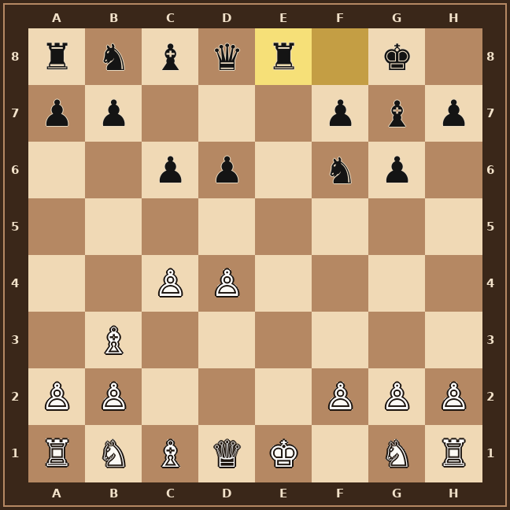

### Hello there! 👋

YouTube creator | Chess player | Gamer | Tech enthusiast

<!-- YT_STATS_START -->
  
<!-- YT_STATS_END -->

---

<!-- CHESS_START -->
### ♟️ Play chess with me!
*It's **me vs. the whole world**, team up with other visitors to outsmart me and claim a win for the guests!*

⬜ **Your turn! Play White (bottom).** Any guest can make the next move. ⚠️ **CHECK!**

**Series score:** Krzys3n **1** : **0** Guests *(Draws: 0)*

#### 🎯 Choose a move (FROM → TO)

| FROM | TO - click a move |
| :---: | :--- |
| **C1** | [E3](https://github.com/Krzys3n/Krzys3n/issues/new?title=chess%3A%20c1e3&body=Chess%20move%3A%20%60c1e3%60%0A%0AClick%20%2A%2ACreate%20new%20issue%2A%2A%20to%20play%20this%20move.) |
| **D1** | [E2](https://github.com/Krzys3n/Krzys3n/issues/new?title=chess%3A%20d1e2&body=Chess%20move%3A%20%60d1e2%60%0A%0AClick%20%2A%2ACreate%20new%20issue%2A%2A%20to%20play%20this%20move.) |
| **E1** | [D2](https://github.com/Krzys3n/Krzys3n/issues/new?title=chess%3A%20e1d2&body=Chess%20move%3A%20%60e1d2%60%0A%0AClick%20%2A%2ACreate%20new%20issue%2A%2A%20to%20play%20this%20move.), [F1](https://github.com/Krzys3n/Krzys3n/issues/new?title=chess%3A%20e1f1&body=Chess%20move%3A%20%60e1f1%60%0A%0AClick%20%2A%2ACreate%20new%20issue%2A%2A%20to%20play%20this%20move.) |
| **G1** | [E2](https://github.com/Krzys3n/Krzys3n/issues/new?title=chess%3A%20g1e2&body=Chess%20move%3A%20%60g1e2%60%0A%0AClick%20%2A%2ACreate%20new%20issue%2A%2A%20to%20play%20this%20move.) |

**Surrender votes (0)** [🏳️ Vote to surrender](https://github.com/Krzys3n/Krzys3n/issues/new?title=chess%3A%20surrender&body=Vote%20to%20surrender%20the%20current%20game.%0A%0AClick%20%2A%2ACreate%20new%20issue%2A%2A%20to%20submit%20your%20vote.)  
*If you feel that the position is lost, you can vote to surrender. If I see two votes in a row, I will reset the board and mark it as a win.*

#### How to play
Click a move link in **FROM → TO** to open a pre-filled Issue, then click **Create new issue**. GitHub Actions validates the move, updates the board, and closes the Issue. *(Inspired by [timburgan](https://github.com/timburgan)).*

#### 🤝 Fair play & community
Feel free to share my profile with friends who know the rules of chess and team up with them to find the best move! As a gentleman's agreement, **no chess engines** I play my moves on my own, and you play yours with pure human brainpower.

#### Last few moves

| Move | Who |
| :--- | :--- |
| F8 to E8 | [@Krzys3n](https://github.com/Krzys3n) |
| E3 to D4 | [@Nlxtz](https://github.com/Nlxtz) |
| E5 to D4 | [@Krzys3n](https://github.com/Krzys3n) |
| D2 to D4 | [@Nlxtz](https://github.com/Nlxtz) |
| E7 to E5 | [@Krzys3n](https://github.com/Krzys3n) |

#### Guest Leaderboard

| Moves | Guest |
| :---: | :--- |
| 21 | [@Mniok](https://github.com/Mniok) |
| 4 | [@Nlxtz](https://github.com/Nlxtz) |
| 1 | [@Shiro99x](https://github.com/Shiro99x) |
| 1 | [@uriel346as](https://github.com/uriel346as) |
| 1 | [@Zafkieli](https://github.com/Zafkieli) |

📜 *Past games history (PGN & stats) will be saved [here](https://github.com/Krzys3n/Krzys3n/tree/main/chess_games/history).*
<!-- CHESS_END -->
