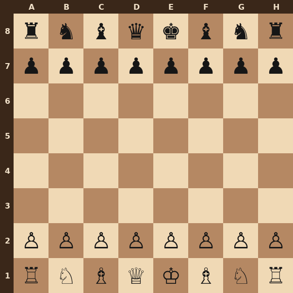

### Hello there! 👋

YouTube creator | Chess player | Gamer | Tech enthusiast

<!-- YT_STATS_START -->
  
<!-- YT_STATS_END -->

---

<!-- CHESS_START -->
### ♟️ Play chess with me!

⬜ **Your turn! Play White (bottom).** Any guest can make the next move.

**Series score:** Krzys3n **0** : **0** Guests *(Draws: 0)*

#### 🎯 Choose a move (FROM → TO)

| FROM | TO - click a move |
| :---: | :--- |
| **A2** | [A3](https://github.com/Krzys3n/Krzys3n/issues/new?title=chess%3A%20a2a3&body=Chess%20move%3A%20%60a2a3%60%0A%0AClick%20%2A%2ACreate%20new%20issue%2A%2A%20to%20play%20this%20move.), [A4](https://github.com/Krzys3n/Krzys3n/issues/new?title=chess%3A%20a2a4&body=Chess%20move%3A%20%60a2a4%60%0A%0AClick%20%2A%2ACreate%20new%20issue%2A%2A%20to%20play%20this%20move.) |
| **B1** | [C3](https://github.com/Krzys3n/Krzys3n/issues/new?title=chess%3A%20b1c3&body=Chess%20move%3A%20%60b1c3%60%0A%0AClick%20%2A%2ACreate%20new%20issue%2A%2A%20to%20play%20this%20move.), [A3](https://github.com/Krzys3n/Krzys3n/issues/new?title=chess%3A%20b1a3&body=Chess%20move%3A%20%60b1a3%60%0A%0AClick%20%2A%2ACreate%20new%20issue%2A%2A%20to%20play%20this%20move.) |
| **B2** | [B3](https://github.com/Krzys3n/Krzys3n/issues/new?title=chess%3A%20b2b3&body=Chess%20move%3A%20%60b2b3%60%0A%0AClick%20%2A%2ACreate%20new%20issue%2A%2A%20to%20play%20this%20move.), [B4](https://github.com/Krzys3n/Krzys3n/issues/new?title=chess%3A%20b2b4&body=Chess%20move%3A%20%60b2b4%60%0A%0AClick%20%2A%2ACreate%20new%20issue%2A%2A%20to%20play%20this%20move.) |
| **C2** | [C3](https://github.com/Krzys3n/Krzys3n/issues/new?title=chess%3A%20c2c3&body=Chess%20move%3A%20%60c2c3%60%0A%0AClick%20%2A%2ACreate%20new%20issue%2A%2A%20to%20play%20this%20move.), [C4](https://github.com/Krzys3n/Krzys3n/issues/new?title=chess%3A%20c2c4&body=Chess%20move%3A%20%60c2c4%60%0A%0AClick%20%2A%2ACreate%20new%20issue%2A%2A%20to%20play%20this%20move.) |
| **D2** | [D3](https://github.com/Krzys3n/Krzys3n/issues/new?title=chess%3A%20d2d3&body=Chess%20move%3A%20%60d2d3%60%0A%0AClick%20%2A%2ACreate%20new%20issue%2A%2A%20to%20play%20this%20move.), [D4](https://github.com/Krzys3n/Krzys3n/issues/new?title=chess%3A%20d2d4&body=Chess%20move%3A%20%60d2d4%60%0A%0AClick%20%2A%2ACreate%20new%20issue%2A%2A%20to%20play%20this%20move.) |
| **E2** | [E3](https://github.com/Krzys3n/Krzys3n/issues/new?title=chess%3A%20e2e3&body=Chess%20move%3A%20%60e2e3%60%0A%0AClick%20%2A%2ACreate%20new%20issue%2A%2A%20to%20play%20this%20move.), [E4](https://github.com/Krzys3n/Krzys3n/issues/new?title=chess%3A%20e2e4&body=Chess%20move%3A%20%60e2e4%60%0A%0AClick%20%2A%2ACreate%20new%20issue%2A%2A%20to%20play%20this%20move.) |
| **F2** | [F3](https://github.com/Krzys3n/Krzys3n/issues/new?title=chess%3A%20f2f3&body=Chess%20move%3A%20%60f2f3%60%0A%0AClick%20%2A%2ACreate%20new%20issue%2A%2A%20to%20play%20this%20move.), [F4](https://github.com/Krzys3n/Krzys3n/issues/new?title=chess%3A%20f2f4&body=Chess%20move%3A%20%60f2f4%60%0A%0AClick%20%2A%2ACreate%20new%20issue%2A%2A%20to%20play%20this%20move.) |
| **G1** | [H3](https://github.com/Krzys3n/Krzys3n/issues/new?title=chess%3A%20g1h3&body=Chess%20move%3A%20%60g1h3%60%0A%0AClick%20%2A%2ACreate%20new%20issue%2A%2A%20to%20play%20this%20move.), [F3](https://github.com/Krzys3n/Krzys3n/issues/new?title=chess%3A%20g1f3&body=Chess%20move%3A%20%60g1f3%60%0A%0AClick%20%2A%2ACreate%20new%20issue%2A%2A%20to%20play%20this%20move.) |
| **G2** | [G3](https://github.com/Krzys3n/Krzys3n/issues/new?title=chess%3A%20g2g3&body=Chess%20move%3A%20%60g2g3%60%0A%0AClick%20%2A%2ACreate%20new%20issue%2A%2A%20to%20play%20this%20move.), [G4](https://github.com/Krzys3n/Krzys3n/issues/new?title=chess%3A%20g2g4&body=Chess%20move%3A%20%60g2g4%60%0A%0AClick%20%2A%2ACreate%20new%20issue%2A%2A%20to%20play%20this%20move.) |
| **H2** | [H3](https://github.com/Krzys3n/Krzys3n/issues/new?title=chess%3A%20h2h3&body=Chess%20move%3A%20%60h2h3%60%0A%0AClick%20%2A%2ACreate%20new%20issue%2A%2A%20to%20play%20this%20move.), [H4](https://github.com/Krzys3n/Krzys3n/issues/new?title=chess%3A%20h2h4&body=Chess%20move%3A%20%60h2h4%60%0A%0AClick%20%2A%2ACreate%20new%20issue%2A%2A%20to%20play%20this%20move.) |

#### How to play
Click a move link in **FROM → TO** to open a pre-filled Issue, then click **Create new issue**. GitHub Actions validates the move, updates the board, and closes the Issue. *(Inspired by [timburgan](https://github.com/timburgan)).*

#### Last few moves

| Move | Who |
| :--- | :--- |
| — | Waiting for the first move |

#### Guest Leaderboard

| Moves | Guest |
| :---: | :--- |
| 0 | No guest moves recorded yet |
<!-- CHESS_END -->
